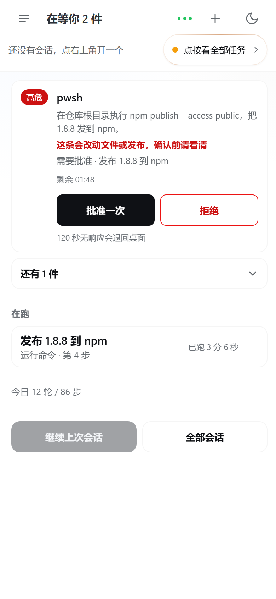

# DSH in Hand (掌上 DSH)

English · [简体中文](README.md)

**This is a plugin for DSH (DeepSeek Harness) that puts a desktop agent session into a phone browser:** you can watch it run, approve a tool call, and answer a question from the phone, without installing an app. The plugin serves one narrow page, `/taskwatch`, from your own DSH instance; the phone reaches it over your LAN, or through a relay you run yourself. It is **not** a cloud service, **not** a native app (nothing from an app store, no build step — at most a PWA icon on the home screen), and it does **not** upload your files to a third party.

|  |  |
|---|---|
| What opens on the phone. | The sidebar entry in the desktop GUI sends the address to your phone. |

## Install

Three steps; the third one is optional.

1. **Install the plugin** on the machine running DSH:

   ```sh
   dsh plugin --profile web add dsh-in-hand
   ```

   Then **restart DSH** — close and reopen the desktop client, or run `dsh web` if you started it from a shell. Plugin rows come from the profile's bundle graph, so nothing changes until you restart.

2. **Open the page on the phone.** On the same Wi-Fi, open the relay's LAN address, `http://<computer-LAN-IP>:3099/taskwatch`; from outside, open the relay's HTTPS address. The first visit asks for a **6-digit pairing code**. The code is shown only on the computer itself, at `http://127.0.0.1:3099/taskwatch/pair`; it is valid for 2 minutes, allows at most 5 attempts, and works once. Entering it gives a 30-day cookie that slides on every visit. (Without a relay, the plugin answers directly on DSH's own port, e.g. `http://127.0.0.1:3080/taskwatch`; there is no pairing and no public entry in that mode.)

3. **Optional: put a public entry in front.** The plugin has no auth of its own and listens on loopback, so a public entry means a relay (or an equivalent TLS reverse proxy) plus a tunnel back to this machine. DSH Web must listen on **3080**: the desktop build otherwise picks a random port, and the port is set through a profile patch, as the Chinese README describes. Deployment templates and a three-step setup live in [`docs/deploy/README.md`](docs/deploy/README.md) (currently in Chinese).

## Security

Plain facts, no promises:

- **The agent runs as you.** A session executes with your user account's permissions, under whatever preset DSH is using (`danger-full-access` by default). The phone page is another way to drive that same session, so treat access to it as access to a terminal on this machine.
- **Approvals happen on the phone; every failure falls back to the desktop.** While a phone page is online, it can claim one `approval/request` and resolve it once as `allow` or `reject`. No phone online, a hidden page, an abort signal, or a timeout (default **120 s**, `approvalTimeoutMs`, 10000–600000) all hand the request back to the desktop. There is no always-allow option: a decision succeeds once — a duplicate is answered with `409`, an expired or already-returned request with `410`.
- **High-risk actions need two steps.** The host decides risk from `toolName + reason + displayReason` (19 patterns by default) and sends only `risk: high | normal` to the page. On a high-risk card, "Approve once" opens an in-card confirmation with the tool and the reason, and only "Confirm" submits. `riskConfirm: false` skips that second step and keeps the badge only.
- **Files are read one at a time.** `/taskwatch/file` serves a single file referenced by that session's messages, up to **50 MB**. No directory listing, no globs, no parent-directory access; symlink escapes are rejected. Anything else is `403 outside-roots`. `DSH_TASKWATCH_ROOTS` is unchanged: still `~/.dsh/attachments` and `~/.dsh/outbox`.
- **Devices can be revoked.** Each browser gets an HttpOnly cookie; the ledger keeps a readable summary name, first/last seen, entry, pairing count and a revoked flag — no IP, no full UA. Revoking the current device asks for confirmation, and its next request gets `401`. At most 50 devices are kept, and entries idle for 30 days are dropped. This is not an account system.
- **The phone never stores the full command text.** Audit lines keep `{at, session, toolName, outcome, by, risk, reason?}` with `reason` cut to 120 characters — no command body, no stdout/stderr. Question audits keep the title, outcome and counts, not the selected option or the custom answer text.
- **Do not expose DSH itself.** The plugin registers only its own `/taskwatch` routes and listens on loopback; it does not proxy the GUI. A public entry must go through a relay that whitelists paths and checks a token or a short-lived ticket. Never publish port 3080 directly.

|  |  |
|---|---|
| A high-risk request: the card says what will change before anything runs. | A normal approval: one decision, a countdown, and a fallback to the desktop. |

## Honest limits

- **It cannot edit an existing long text input on the agent's behalf.** A half-written prompt in the desktop composer, or a free-form form field, is not part of any request the phone can claim, so the phone will not compose a replacement and write it there.
- **On iOS, add it to the Home Screen to get the app-like shell** (icon, fullscreen, no address bar). That is a PWA, not a native app, and there is no true background refresh: polling stops when you leave the page and resumes when you come back.
- **Files outside `attachments` / `outbox` that the session never referenced stay invisible**, even if you know the path. The read route widens only to absolute paths quoted in that session's messages, one file per request.
- **Real-device behavior is yours to verify.** Screenshots and UI checks come from real Chrome over CDP at 390 px width with injected data; camera capture on iOS Safari, HEIC input, and a 2.5 MB upload on a weak network have only been simulated.
- **UI copy is Chinese only.** There is no i18n yet; this file documents the plugin, it does not translate the interface.
