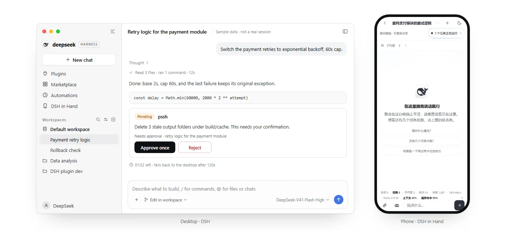
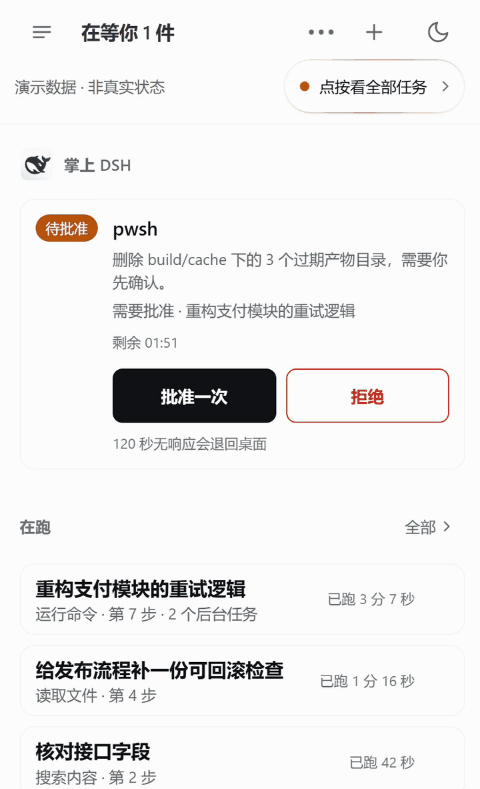
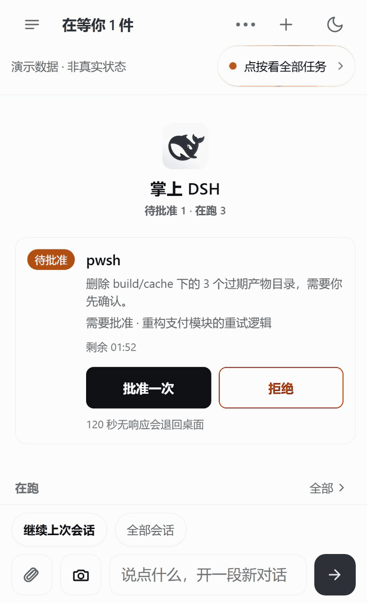
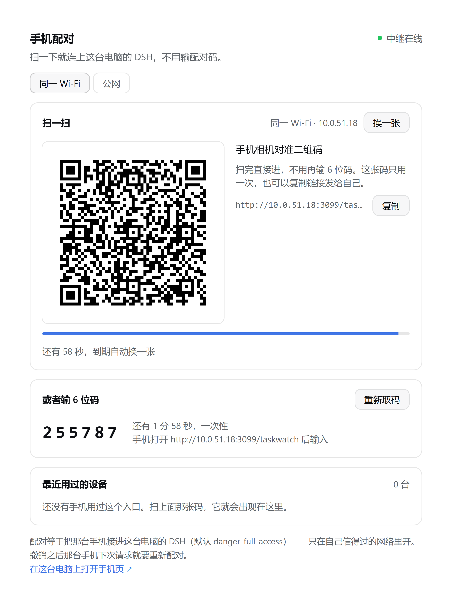
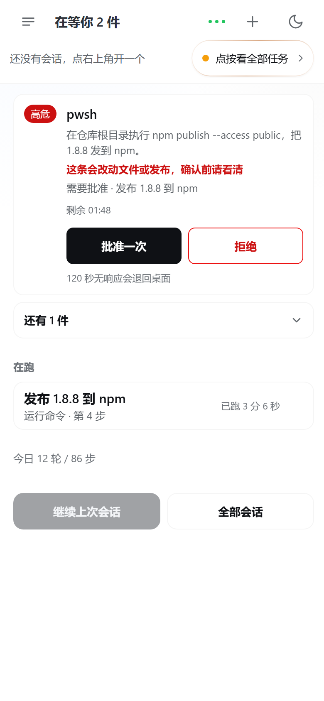
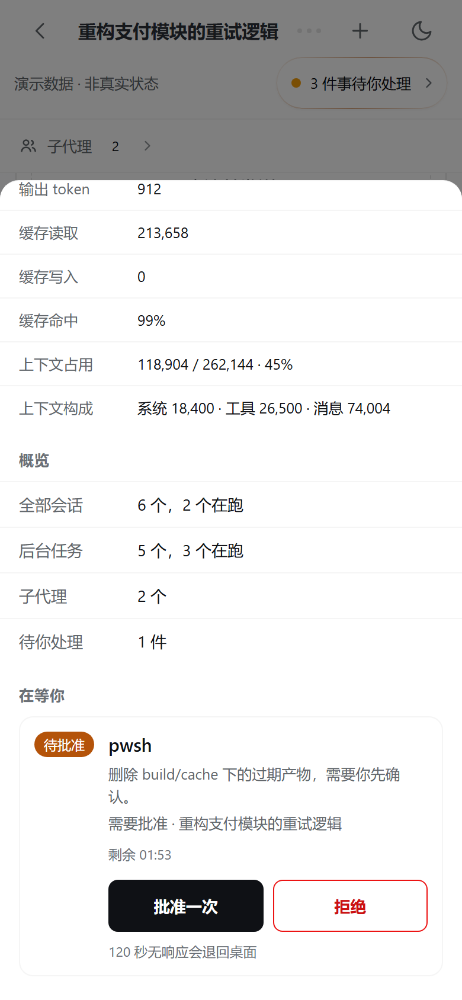

# DSH in Hand (掌上 DSH)

English · [简体中文](README.md)

<p align="center">
  
</p>

<p align="center">Desktop on the left, phone on the right: one DSH. Talk to it from your phone, and approvals are one tap away too.</p>

<p align="center">
  <a href="https://github.com/dingchenhui0618-arch/dsh-in-hand/releases/latest"></a>
  
  
  
  =0.2.1-rc.2 <0.3.0" src="https://img.shields.io/badge/DSH-0.2.1_%E2%80%93_0.3.0-4d6bfe?style=flat-square">
  <a href="https://github.com/dingchenhui0618-arch/dsh-in-hand/actions/workflows/ci.yml"></a>
  <a href="https://www.npmjs.com/package/dsh-in-hand"></a>
  <a href="LICENSE"></a>
</p>

| | |
|---|---|
| Form | One web page (`/taskwatch`) — no app, no store |
| Platform | iOS Safari · Android Chrome; can be added to the home screen as a PWA |
| Runtime deps | **0** — a single-file page, no framework, no CDN, works offline |
| DSH version | `>=0.2.1-rc.2 <0.3.0` (declared in `engines.dsh`; tested end to end on the Windows desktop build, nightly channel) |
| Public access | Built-in relay: no public IP, no port forwarding |
| Authorisation | One scan from the desktop sidebar's **Phone pairing** panel; a 6-digit code still works. Per device, revocable anytime |

<p align="center">
  
  
  
</p>

<p align="center">Left: approve from the home card · Middle: pick a session in the drawer · Right: text size and light/dark</p>

**This is a plugin for DSH (DeepSeek Harness) that puts a desktop agent session into a phone browser:** you can watch it run, approve a tool call, and answer a question from the phone, without installing an app. The plugin serves one narrow page, `/taskwatch`, from your own DSH instance; the phone reaches it over your LAN, or through a relay you run yourself. It is **not** a cloud service, **not** a native app (nothing from an app store, no build step — at most a PWA icon on the home screen), and it does **not** upload your files to a third party.

## Install

Three steps; the third one is optional.

1. **Install the plugin** on the machine running DSH:

   ```sh
   dsh plugin --profile web add dsh-in-hand
   ```

   Then **restart DSH** — close and reopen the desktop client, or run `dsh web` if you started it from a shell. Plugin rows come from the profile's bundle graph, so nothing changes until you restart.

2. **Bring the phone in.** In the desktop sidebar open **Phone pairing** and scan the QR code with the phone camera — that is the whole step (the code rotates every 60 s and works once). Without a camera, type the 6-digit code shown in the same panel; the LAN address is `http://<computer-LAN-IP>:3099/taskwatch`, the HTTPS relay address from outside. A code gives a 30-day cookie that slides on every visit. (Without a relay, the plugin answers directly on DSH's own port, e.g. `http://127.0.0.1:3080/taskwatch`; there is no pairing and no public entry in that mode.)

3. **Optional: put a public entry in front.** The plugin has no auth of its own and listens on loopback, so a public entry means a relay (or an equivalent TLS reverse proxy) plus a tunnel back to this machine. DSH Web must listen on **3080**: the desktop build otherwise picks a random port, and the port is set through a profile patch, as the Chinese README describes. Deployment templates and a three-step setup live in [`docs/deploy/README.md`](docs/deploy/README.md) (currently in Chinese).

## Phone pairing

The sidebar has a second entry, **Phone pairing**, that does one thing: get a phone in.



- **Scan.** The QR code rotates every 60 seconds. It does not contain the 6-digit code; it contains a **single-use hop ticket** (v3, audience `remote`, 60 s, burnt on use) appended to the LAN entry. The phone camera opens it, the relay redeems it, a 30-day cookie is set, and the browser lands on `/taskwatch` — no typing at all.
- **Type, if you must.** Camera broken or the screen is too far away: the panel also shows the 6-digit code (2 minutes, 5 attempts, single use) by asking the relay's own mint endpoint.
- **Recently seen devices.** Which device, which entry, how long ago. Revoking takes two taps (the button turns into "Confirm revoke"); the next request from that device gets `401`.
- **It says why when it cannot connect.** Relay not running, relay listening on loopback only (no `.lan` marker), no `publicUrl`, or a configured LAN address that is no longer on this machine — all four are named in the panel instead of leaving a dead QR code.

The relay needs no change: both sides share the ticket secret (`<home>/.dsh/taskwatch-ticket.key`), which hop tickets already relied on. The QR code is rendered by the host (`lib/qr.js` over a vendored `qrcode-generator`, MIT) — **no runtime dependency**, no external image host or CDN.

**One precondition: the relay has to run on the same computer as the plugin.** The panel's only two candidates are the configured `lanUrl` and `127.0.0.1` on the same port, and it signs tickets with this machine's `~/.dsh/taskwatch-ticket.key`. So with a relay that lives on a server (the [`docs/deploy/`](docs/deploy/README.md) layout), asking it for a code fails ("the relay is not running on this computer"), and a scanned ticket is not redeemed either: that relay has no copy of the key and does not accept v3 tickets, so the phone just lands on the pairing page. For that layout, pair once through the relay's own page (`ssh -N -L 13099:127.0.0.1:3099 root@your-server`, then open `http://127.0.0.1:13099/taskwatch/pair`).

## Security

Plain facts, no promises:

- **The agent runs as you.** A session executes with your user account's permissions, under whatever preset DSH is using (`danger-full-access` by default). The phone page is another way to drive that same session, so treat access to it as access to a terminal on this machine.
- **Approvals happen on the phone; every failure falls back to the desktop.** While a phone page is online, it can claim one `approval/request` and resolve it once as `allow` or `reject`. No phone online, a hidden page, an abort signal, or a timeout (default **120 s**, `approvalTimeoutMs`, 10000–600000) all hand the request back to the desktop. There is no always-allow option: a decision succeeds once — a duplicate is answered with `409`, an expired or already-returned request with `410`.
- **High-risk actions need two steps.** The host decides risk from `toolName + reason + displayReason` (19 patterns by default) and sends only `risk: high | normal` to the page. On a high-risk card, "Approve once" opens an in-card confirmation with the tool and the reason, and only "Confirm" submits. `riskConfirm: false` skips that second step and keeps the badge only.
- **Files are read one at a time.** `/taskwatch/file` serves a single file referenced by that session's messages, up to **50 MB**. No directory listing, no globs, no parent-directory access; symlink escapes are rejected. Anything else is `403 outside-roots`. `DSH_TASKWATCH_ROOTS` is unchanged: still `~/.dsh/attachments` and `~/.dsh/outbox`.
- **Devices can be revoked.** Each browser gets an HttpOnly cookie; the ledger keeps a readable summary name, first/last seen, entry, pairing count and a revoked flag — no IP, no full UA. Revoking the current device asks for confirmation, and its next request gets `401`. At most 50 devices are kept, and entries idle for 30 days are dropped. This is not an account system.
- **The phone never stores the full command text.** Audit lines keep `{at, session, toolName, outcome, by, risk, reason?}` with `reason` cut to 120 characters — no command body, no stdout/stderr. Question audits keep the title, outcome and counts, not the selected option or the custom answer text.
- **Starring uses GitHub OAuth Device Flow (v1.8.23).** Tapping "star" only opens a panel: the host asks GitHub for an 8-digit device code, and only after you enter it and confirm on GitHub does the host star the repo as your own account. The request uses an **empty scope** (public star only — no private repos, no profile), and the access token lives **in host memory for a few seconds**: it is used for the star immediately, then nulled and the flow deleted — never logged, never written to disk, never returned to the page. Revoke it anytime at `github.com/settings/applications`. This only happens after **your own click and your own confirmation on GitHub**; there is no automatic or bulk starring.
- **Do not expose DSH itself.** The plugin registers only its own `/taskwatch` routes and listens on loopback; it does not proxy the GUI. A public entry must go through a relay that whitelists paths and checks a token or a short-lived ticket. Never publish port 3080 directly.

|  |  |
|---|---|
| A high-risk request: the card says what will change before anything runs. | A normal approval: one decision, a countdown, and a fallback to the desktop. |

## Honest limits

- **It cannot edit an existing long text input on the agent's behalf.** A half-written prompt in the desktop composer, or a free-form form field, is not part of any request the phone can claim, so the phone will not compose a replacement and write it there.
- **On iOS, add it to the Home Screen to get the app-like shell** (icon, fullscreen, no address bar). That is a PWA, not a native app, and there is no true background refresh: polling stops when you leave the page and resumes when you come back.
- **Files outside `attachments` / `outbox` that the session never referenced stay invisible**, even if you know the path. The read route widens only to absolute paths quoted in that session's messages, one file per request.
- **Real-device behavior is yours to verify.** Screenshots and UI checks come from real Chrome over CDP at 390 px width with injected data; camera capture on iOS Safari, HEIC input, and a 2.5 MB upload on a weak network have only been simulated.
- **UI copy is Chinese only.** There is no i18n yet; this file documents the plugin, it does not translate the interface.
