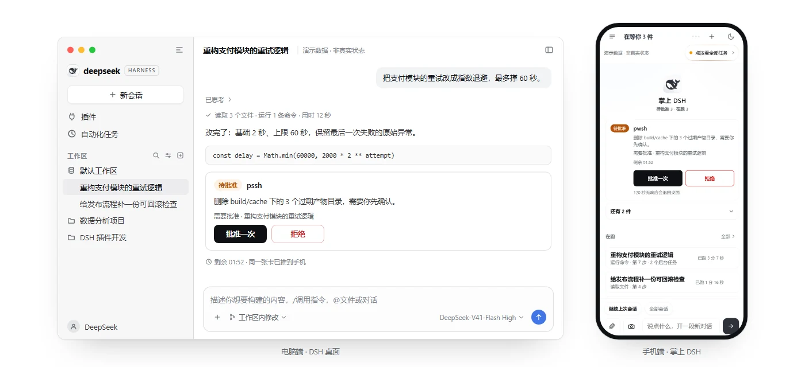
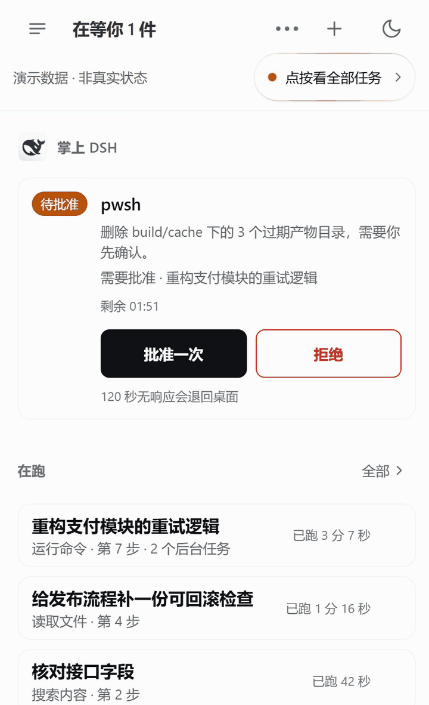
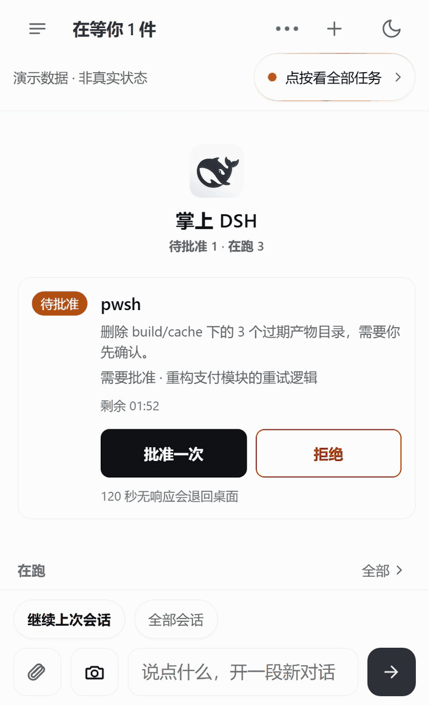
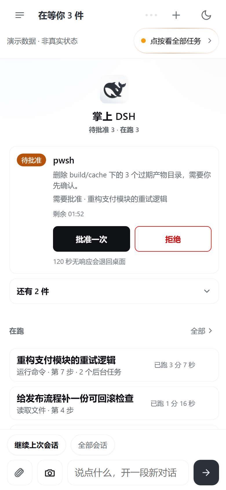
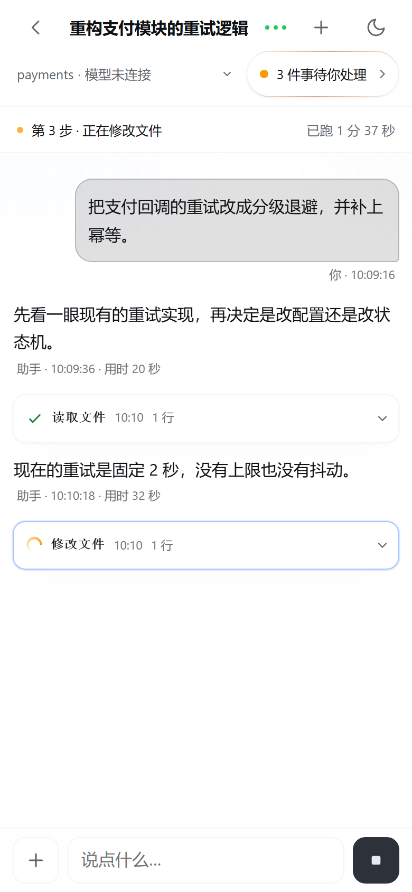
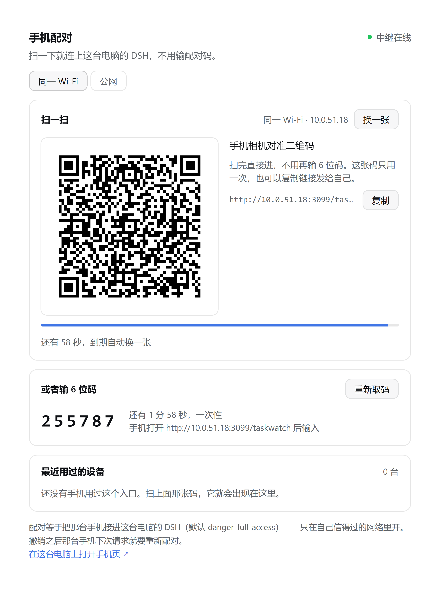
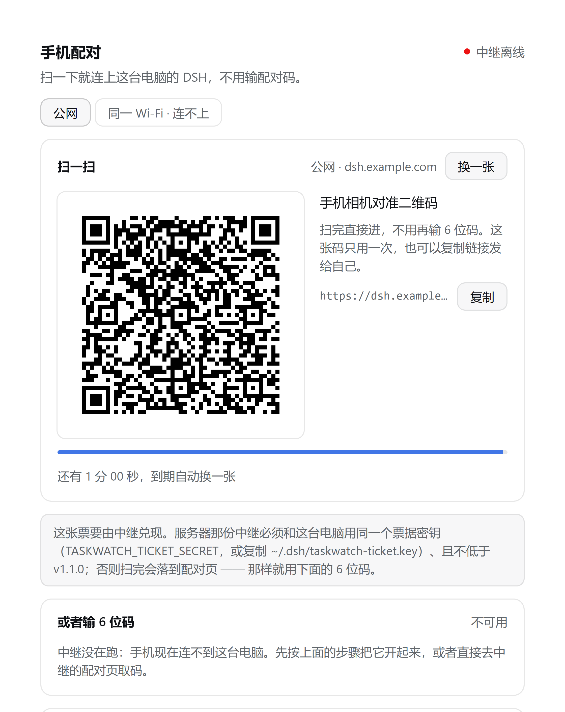

# 掌上 DSH（dsh-in-hand）

[English](README.en.md) · 简体中文

<p align="center">
  
</p>

<p align="center">左边电脑、右边手机：同一个 DSH。手机上随时开口，要你批准的也在这里点掉。</p>

<p align="center">
  <a href="https://github.com/dingchenhui0618-arch/dsh-in-hand/releases/latest"></a>
  
  
  
  =0.2.1-rc.2 <0.3.0" src="https://img.shields.io/badge/DSH-0.2.1_%E2%80%93_0.3.0-4d6bfe?style=flat-square">
  <a href="https://github.com/dingchenhui0618-arch/dsh-in-hand/actions/workflows/ci.yml"></a>
  <a href="https://www.npmjs.com/package/dsh-in-hand"></a>
  <a href="LICENSE"></a>
</p>

| 项目 | 说明 |
|---|---|
| 形态 | 一个网页（`/taskwatch`），不装 App、不上架商店 |
| 平台 | iOS Safari · Android Chrome；可「添加到主屏幕」当 PWA 用 |
| 运行时依赖 | **0** —— 单文件页面，无框架、无 CDN、离线可用 |
| DSH 版本 | `>=0.2.1-rc.2 <0.3.0`（`engines.dsh`，Windows 桌面版 nightly 通道实测过的范围） |
| 公网访问 | 自带中继：不用公网 IP、路由器不做端口映射 |
| 授权 | 桌面侧栏「手机配对」扫一下二维码即可接入；也可以用 6 位配对码手输。一机一码，可随时吊销 |

<p align="center">
  
  
  
</p>

<p align="center">左：待批准一次点掉 · 中：抽屉里挑会话 · 右：字号与明暗</p>

它是 **DSH（DeepSeek Harness）的一个插件**，把桌面上的 agent 会话搬进手机浏览器：看着它跑、替它按一次「批准」、回它一个问题，不用装 App。插件只在自己的 DSH 里多开一个窄页面 `/taskwatch`；手机就近走局域网，人在外面走你自己搭的中继。它**不是**云服务，**不是**原生 App，也**不会**把你的文件传到第三方。

[上手](#30-秒上手) · [界面](#界面) · [能力](#能力) · [手机怎么进来](#手机怎么进来) · [手机配对](#手机配对) · [安装](#安装) · [配置](#配置) · [安全边界](#安全边界) · [已知限制](#已知限制) · [文档](#文档)
## 30 秒上手

1. **装插件**（在跑 DSH 的那台电脑上）：`dsh plugin --profile web add dsh-in-hand`
2. **重启 DSH**：桌面客户端关掉再打开（命令行装的用 `dsh web`）—— 插件行来自 profile 的 bundle 图，不重启不生效。
3. **手机接入**：桌面侧栏点「手机配对」，用手机相机扫那张二维码就进去了（60 秒一换、只用一次）。
   扫不了就手输面板里的 6 位码 —— 同一 Wi-Fi 用中继的局域网地址 `http://<电脑的内网 IP>:3099/taskwatch`，
   人在外面用中继的 HTTPS 域名。

## 界面

上面三段 GIF 是首页、抽屉与明暗切换；下面这张静态图看信息层次，再往下是 v1.10.0 的运行条：

<p align="center">
  
</p>

<p align="center"><em>首页：最上面是「待批准 N · 在跑 M」，第一张卡直接能点「批准一次」，底部钉着输入框。</em></p>

有任务在跑时，header 下面会多一条 44px 的**运行条**：`第 3 步 · 正在修改文件`，右边是 `已跑 1 分 37 秒`。步数按本轮的 `step/start` 数，当前动作取最近一个还没出结果的工具调用；**不画百分比** —— 宿主只说"第几步"，不说"一共几步"，没有分母的进度条是在编。右图同时是**简洁模式**：输入区只剩「+ / 输入框 / 发送」，指标两行收进了抽屉。

<p align="center">
  
</p>

<p align="center"><em>运行条 + 简洁模式：跑到第几步、正在干什么、已经多久，抬头就能看到。</em></p>

首页的「在跑」只有三条，开四五个会话就得一页页翻 —— 所以并行视图（首页「在跑」右上角「全部」，或抽屉里的「并行视图」）把排序写死为一句话：**需要你（待批准 / 待回答） → 失败 → 运行中 → 已完成最近**，同组按最后活动时间倒序。这不是"红的最显眼"，而是分组本身：即使把颜色全去掉，失败仍然在运行中与空闲之上。

页面**不做仪表盘**：顶部一行说人话的状态（点开才是数据表），中间是对话，数据表格收进抽屉；工具调用翻译成人话（`pwsh` → 「运行命令」），逐字输出只改一个节点。动效「纸墨微动」——位移 ≤3px、每个动效都携带信息，不放光、不放烟花。每一屏的样子与为什么这么排，见 [页面实现笔记](docs/notes/impl.md) 与 [截图索引](docs/screenshots/README.md)。

## 能力

| 能力 | 你得到什么 |
|---|---|
| **接着聊** | 还是桌面上那批会话，手机上回一句就继续，逐字看着它跑；可以打断、切换会话与模型、重排下一轮队列（「立即发送」走宿主原生 steer）。 |
| **一次批准** | 手机在线时，待批准卡片多出「批准一次 / 拒绝」。没有手机在线、超时、桌面先处理都会立刻交还桌面；不做 always-allow，重复提交 `409`。 |
| **回答提问** | 选项式提问与计划审批也能在手机上答：单选 / 多选 / 多题 / 自定义回答，逐题不答完提交键保持禁用。 |
| **高危两步** | 判定在宿主侧（`assessRisk`），页面只收到 `risk:'high'`；高危卡点「批准一次」先在卡片里展开工具与原因，只有「确认执行」才发请求。 |
| **交付物直接看** | 生成好的图与 PDF 在这一页就能打开（单个 ≤50 MB）；附件按内容识别，不认扩展名。 |
| **拍一张直接发** | 相机键唤起系统相机，拍完就在输入区看到缩略图；发送前在手机上压到长边 1600，原图不出手机。 |
| **设备与入口** | 抽屉里列最近用过的设备、逐台撤销（撤销自己要二次确认）；家里 / 公司多台机器做成一份入口清单，点一下就切。 |
| **推到手边** | 有东西卡住时推到飞书、微信（Server酱），或者用 Web Push 直接上锁屏 —— 不需要第三方账号、不产生费用。 |
| **确认表单** | 装了 `dsh-genui` 的话，助手回复里的 `dsh-ui` 围栏能在手机上渲染成可点的确认表单（text / radio / checkbox / input / textarea / submit）。 |
| **进度看得见** | 运行中多一条运行条：第几步、正在改哪个文件、已跑多久。时长每秒走，重连也不会把画面重画一遍。 |
| **简洁模式** | 抽屉「显示设置」里一键收掉指标两行，附件与拍照并成一个「+」（文件 / 图片 / 拍照三项都在）。偏好跟着这台手机走，默认关。 |

细节都在 [功能与界面细节](docs/notes/features.md)：每一版的失败语义、边界条件、以及为什么这么做（连同通知、相机、确认表单的界面截图）。

## 手机怎么进来

| 路 | 地址 | 前提 |
|---|---|---|
| **扫码**（最省事） | 桌面侧栏「手机配对」→ 手机相机扫 | 中继在跑；公网码要求中继与宿主同一个票据密钥 |
| **6 位码** | `http://<内网 IP>:3099/taskwatch`（同一 Wi-Fi）或中继的 HTTPS 域名 | 面板里那张码 2 分钟、最多试 5 次、一次性 |
| **局域网直连** | `http://192.168.x.x:3099/taskwatch` | 中继放一个空的 `.lan` 标记文件（或 `RELAY_LAN=1`）并重启 |

换到的 cookie 是 30 天、每次访问滑动续期。**想装成主屏幕图标必须走 HTTPS**（或 localhost）：`http://` 不是安全上下文，装不成 PWA、也没有离线壳。两条路的细节、连接原理、502 分层排查见 [远程入口笔记](docs/notes/remote.md)。

## 手机配对

侧边栏的第二条入口，只干一件事：**把手机接进来**。

| | |
|---|---|
|  |  |
| 中继就在这台电脑上：扫这张，什么都不用输。 | 中继在服务器上、本机探不到：码下面直说前提（状态图为构造，域名换成示例）。 |

- **扫一扫**：二维码 60 秒一换。里面装的不是 6 位码，而是一张**一次性换路票据**（v3、受众 `remote`、60 秒、用后即焚）拼在局域网入口地址后面：手机相机扫到 → 中继当场兑换 → 种下 30 天 cookie → 跳回 `/taskwatch`，全程不用输入任何东西。
- **6 位码兜底**：摄像头坏了、隔着屏幕拍不清就手输。面板把中继的取码端点转一手（那个端点只认 `127.0.0.1`），把码显示在这里。
- **最近用过的设备**：哪台设备、走哪条入口、多久前活动过。撤销是两步，撤销后那台手机下一次请求就 `401` 并提示重新配对。
- **连不上时说原因**：中继没在跑 / 只监听回环 / 没配 `publicUrl` / 配置里的局域网地址已不是这台机器的网卡 —— 四种都在面板里点名，而不是给一张不动的二维码。

同一台电脑上，中继一行代码都不用改：票据密钥两边共用（`~/.dsh/taskwatch-ticket.key`）。二维码由宿主自己画（`lib/qr.js` + vendored 的 `qrcode-generator`，MIT），**不加任何运行时依赖**，也不请求外部图床。

**中继单独跑在服务器上时**（[`docs/deploy/`](docs/deploy/README.md) 那套），扫码也能用，但要多做两件事：服务器那份中继 ≥ **v1.1.0**（它才认 v3 票），并且和这台电脑用**同一个**票据密钥（装的时候给 `--ticket-secret-file`，或把值写进 `/etc/taskwatch-relay/env` 的 `TASKWATCH_TICKET_SECRET=`）。没做这两件事时：取码会失败并直说「中继没在这台电脑上运行」；扫码能签出票，但服务器那边兑不掉，手机落在配对页 —— 这时用 6 位码那条老路（`ssh -N -L 13099:127.0.0.1:3099 root@你的服务器`，再开 `http://127.0.0.1:13099/taskwatch/pair`）。

**远端要能动手，中继得是 v1.2.0**：1.1.0 只转发「读取 + 发消息 + 传文件」，所以在手机上点**批准 / 回答 / 重排队列 / 撤销设备 / 配通知**会 404。1.2.0 把白名单补成 35 条，并在 `/taskwatch/lan.json` 里声明能力；插件据此判断，旧中继上会直接把「需要 1.2.0」写在卡片上，而不是留一个按了没反应的按钮。

*(右图的中继状态是构造的、域名换成了示例域名；面板组件、二维码与其余字段都来自真实宿主。)*

## 安装

```sh
dsh plugin --profile web add dsh-in-hand
```

装完**重启 DSH**：桌面客户端关掉再打开，命令行装的用 `dsh web`。插件行来自 profile 的 bundle 图，而 client 侧模块元数据按 specifier 缓存且没有失效路径，所以增删插件一律要重启才生效。

- **环境**：Node ≥ 20（`engines.node`）。`engines.dsh` 声明 `>=0.2.1-rc.2 <0.3.0` —— 这是端到端跑过的范围，更低版本（含 0.1.x 稳定线）没有验证过，装上去可能直接报错。这是「声明与实测一致」，不是故意收紧门槛。
- **没有构建步骤**：`lib/` 是提交进仓库、可直接运行的产物，客户端 bundle 就是一个调用 `window.__ModuleLoader__.load` 的普通脚本；从源码安装不需要任何构建授权。
- **本地开发**可以直接指向工作副本：`dsh plugin --profile web add <绝对路径>/dsh-in-hand`。注意 profile 自带补丁里若写路径必须是绝对路径（相对路径相对补丁文件解析，跨盘会失败）。
- **公共入口的前提**是 DSH Web 固定在 **3080**：桌面版把 `--port 0` 写死（每次随机），唯一「升级不丢」的入口是用 profile 补丁覆盖 `webserver` 行。补丁怎么打、改端口时哪三处要一起改，见 [远程入口笔记](docs/notes/remote.md)。

## 配置

```yaml
- insert:
    - id: dsh-in-hand
      name: dsh-in-hand
      config:
        publicUrl: https://dsh.example.com
        lanUrl: http://192.168.1.5:3099     # 指向中继的局域网入口（有令牌门）
        approveFromPhone: true              # 默认 true；false 时完全退回只观测
        approvalTimeoutMs: 120000           # 默认 120000，允许 10000–600000
        riskConfirm: true                   # 默认 true；false 时高危只显示徽标、点击直接提交
        # highRiskPatterns:                 # 默认 19 条；给了就替换默认清单
        #   - rm -rf
```

- `publicUrl` 只决定「公网入口长什么样」，也支持环境变量 `DSH_TASKWATCH_PUBLIC_URL`；代码里不写死任何域名。没配时 `ticket` 的远端请求回 `409 no-public-entry`。
- `approveFromPhone: false` 让手机完全退回只观测：两种待办都只显示，不出现操作按钮。
- 越界的数值取边界值并在启动时 warn，不是悄悄回默认值。`highRiskPatterns` 最多 64 条、每条 ≤120 字符。
- **插件自己的路由没有令牌门**（授权由中继那层负责），所以 `lanUrl` 建议指向有鉴权的中继，而不是直接指回插件宿主。

## 安全边界

用之前记住这几件事（逐条理由见 [安全边界笔记](docs/notes/security.md)）：

- **公网入口必须带令牌或一次性票据才能进。** 票据 60 秒过期、带签名校验、绑受众，用过的会作废；「作废」是各进程自己记账，不是跨进程的全局一次性。
- **中继只转发白名单里的接口**，不是任意代理；插件只在**回环**上监听，从不对外。中继 ≥ **v1.2.0** 时这张白名单是**完整控制面**（读与写都在表里，共 35 条）——持有配对 cookie 的人等于持有这台机器的终端，这句话在中继的 SECURITY.md 里也写着。
- **插件自带的局域网入口没有令牌门**（GUI 本身也没有认证）。所以**不要把 DSH 的端口直接暴露到公网**，要走中继。
- **能打开手机页 = 能驱动这台机器上的 agent**（DSH 默认 `danger-full-access`）。手机端的一次性放行就是把写权限延伸到手机，不想要就设 `approveFromPhone: false`。
- **高危动作两道确认**，判定在宿主侧，页面只收到 `risk`。这是一道按可见信息加的门槛，不是命令级沙箱 —— 真正的权限边界仍然是桌面端。
- **不记命令全文。** 审批审计只有 `{at, session, toolName, outcome, by, risk, reason?}`（`reason` 截到 120 字）；提问审计不记选了哪一项、也不记自定义回答原文。
- **文件一次一个。** `/taskwatch/file` 只服务本会话消息里引用过的**单个文件**（≤50 MB），不支持目录列举、通配、父目录访问，符号链接逃逸被拒。
- **票据密钥在 `~/.dsh/taskwatch-ticket.key`**，只给当前用户读，绝不进任何仓库；轮换它只作废未兑换的票，不影响已发的 30 天 cookie。

## 已知限制

- 界面文案目前是**中文**，还没有做多语言。
- 服务**没有鉴权**，不要直接暴露到公网；请在前面加一层（中继）。
- `/taskwatch/session` 只覆盖**内存中**的活跃会话；落盘但未加载的会话读不到（会明确报错，不返回空列表）。
- 会话、任务、子代理各列表最多渲染 40 条（GUI 面板 30 条）；单条消息超过 4000 字符会被截断。
- 手机端能做的是「一次性批准 / 拒绝一次工具调用」与「一次性回答一次提问」；**不能**替 agent 修改已有的长文本输入。
- **运行中只说「第几步」，没有总步数**：宿主不提供一轮的总步数，所以运行条只报已发生的步数与本轮用时，不画百分比进度条。
- **远端"能动手"需要中继 ≥ v1.2.0**：1.1.0 只转发读取、发消息与上传，批准 / 回答 / 设备 / 通知在远端会 404（页面会直说版本不够，不会留一个没反应的按钮）。
- 子代理会话不出现在手机列表里（它们是宿主内部的干活会话，日志都要靠父地址才能读）。
- **真机验收尚未完成**：截图与交互自检来自真 Chrome + CDP（DPR2、390 宽）与注入状态；iOS Safari 的相机入口形态、HEIC 输入、弱网下的 2.5 MB 上传、Wi‑Fi ↔ 4G 切换、锁屏十分钟、iOS bfcache 回来，都只做过模拟。
- **页面还没有 CSP**。它与 DSH Web GUI 同源，而后者没有鉴权且默认 `danger-full-access`，所以任何一次漏转义都等于入口失守。现有四处（正文、工具提示、工具名、会话标题）要么走 `textContent`、要么经 `esc()`，并有契约测试钉着，但那只是**代理**、不等于「全页面无 XSS」。加一层带 sha256 hash 的 `Content-Security-Policy` 是本项目最值得做的下一步加固。

逐条原文（含 SSE 断线边界、冷会话标题要现读、会话 id 只做排版不算脱敏、v1.8.1 文件放宽的真机状态）见 [已知限制完整清单](docs/notes/limits.md)。

## 文档

| 想知道 | 看 |
|---|---|
| 每项能力当时为什么这么做、失败是什么语义、哪个版本加的 | [功能与界面细节](docs/notes/features.md) |
| 手机页的实现笔记：轮询、断网重连、整页重建、几个只有端到端才露出来的坑 | [页面实现笔记](docs/notes/impl.md) |
| 全部 HTTP 路由、请求体、错误码，以及从宿主软读了哪些服务 | [接口与采集面](docs/notes/api.md) |
| 外网 / 局域网两条路、SSH 反向隧道、换路票据格式、502 排查 | [远程入口笔记](docs/notes/remote.md) |
| 安全边界逐条（含票据一次性、文件放宽、点星授权） | [安全边界笔记](docs/notes/security.md) |
| 已知限制的逐条原文与真机验收现状 | [已知限制完整清单](docs/notes/limits.md) |
| 每个 check 脚本在证明什么、宿主那一半为什么也要钉住 | [开发与测试](docs/notes/dev.md) |
| 中继怎么部署在服务器上（三步、nginx 模板、体检脚本） | [中继部署文档](docs/deploy/README.md) |
| 截图清单、用途与历史版本 | [截图索引](docs/screenshots/README.md) |
| 不用装任何东西、用浏览器点着看的演示页 | [演示页](docs/demo.html) |

## 开发

```sh
npm run check                   # bundle、文件边界、上传路由、页面契约与票据 HMAC 互认测试
node scripts/make-icons.mjs     # 重新生成图标（自实现 PNG 编码，零依赖）
node scripts/make-demo.mjs      # 生成 docs/demo.html（假数据，供截图与预览）
```

`check` 里 29 个脚本都是**真跑**的：`check-bundle.mjs` 会 import 宿主半边，断言 `name` / `apply` / `inject` 三个导出、`cordis.patch.yml`、`exports` 与 `dsh` 元数据；`check-files.mjs` 覆盖 75 项文件边界；`check-webpush.mjs` 拿 RFC 8291 附录 A 的测试向量逐字节比对；中继那侧在本机存在时是**真的 spawn 一个临时端口实例**（不碰 3099 生产进程），不在本机时明确 SKIP。

每个脚本在证明什么、为什么连「装好了却不报错」这种坑也要写成断言，见 [开发与测试](docs/notes/dev.md)。

## 许可证

Apache-2.0，见 [LICENSE](LICENSE)。
