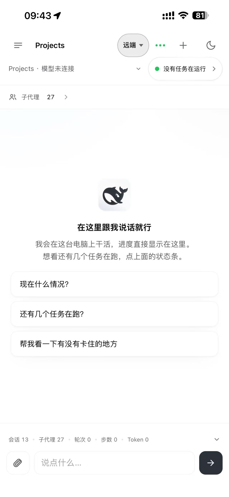
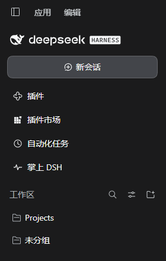
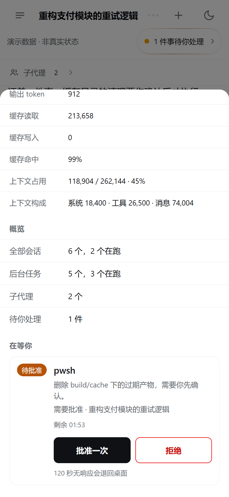
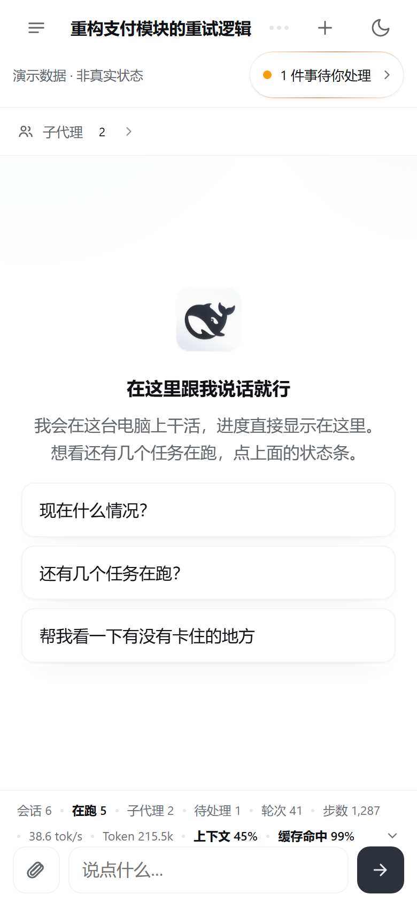
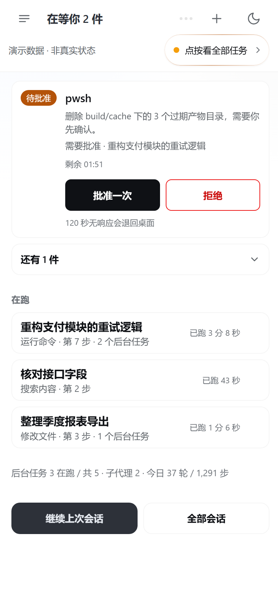
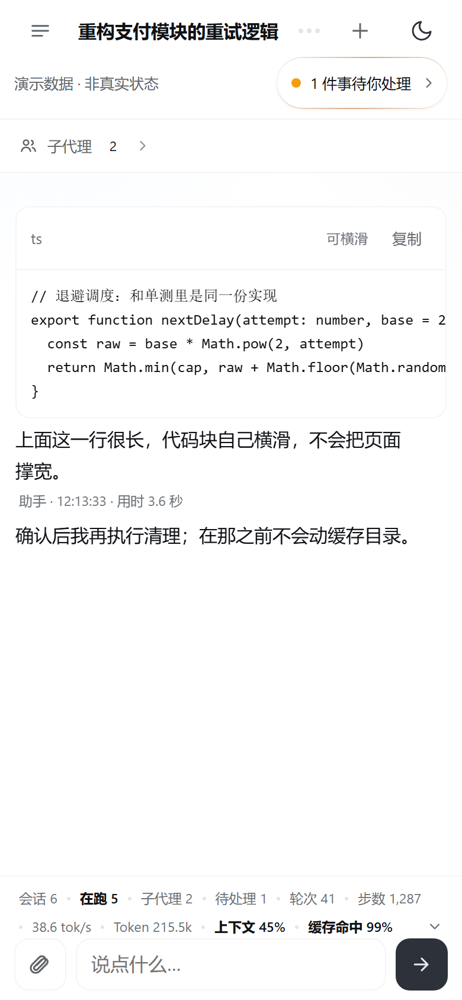
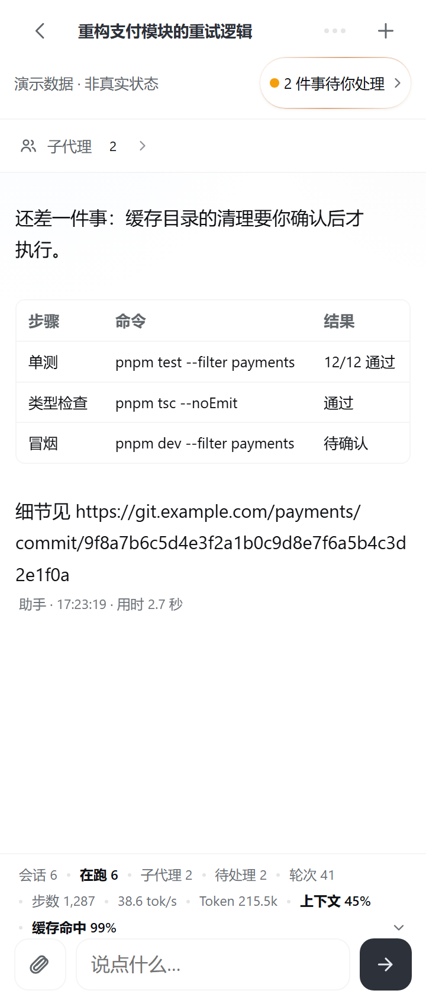

# 掌上 DSH（dsh-in-hand）

[](https://github.com/dingchenhui0618-arch/dsh-in-hand/actions/workflows/ci.yml)
[](https://www.npmjs.com/package/dsh-in-hand)
[](LICENSE)

**把电脑上的 DSH 会话搬到手机**：不用装 App，打开一个网页就能接着聊、看进度、收文件。

形态就是一个网页：手机浏览器打开即可。同一个 Wi-Fi 下走局域网直连，人在外面走经中继的公网入口，两条路在页面右上角随时切。

> 用着还行的话，点个 ⭐ 就够了——插件市场的「搜插件」按 GitHub star 排序，star 是这个插件能被人翻到的唯一杠杆。

|  |  |
|---|---|
| 手机上打开就是这样一个页面。 | 桌面端侧边栏点「掌上 DSH」进来，面板里能把地址发到手机。 |

## 30 秒上手

1. **装插件**（在跑 DSH 的那台电脑上）：`dsh plugin --profile web add dsh-in-hand`
2. **重启 DSH**：桌面客户端关掉再打开（命令行装的用 `dsh web`）—— 插件行来自 profile 的 bundle 图，不重启不生效。
3. **手机打开**：同一 Wi-Fi 用中继的局域网地址 `http://<电脑的内网 IP>:3099/taskwatch`，人在外面用中继的 HTTPS 域名；首次进配对页输一次 6 位码。

## 为什么用它

- **不用公网 IP**：电脑在 NAT 后面也能连上，路由器不用做端口映射。
- **能接着聊**：还是桌面上那批会话，手机上回一句就继续，逐字看着它跑。
- **能批一次**：手机在线时，待批准卡片直接给「批准一次 / 拒绝」；超时或手机切走就自动退回桌面（v1.8.0）。
- **等待和交付物都在这一页**：哪件事在等你、进度到哪，展开就能看；生成好的图和 PDF 直接打开。

## 从只读监控长成手机客户端

它起初只是一份只读的**任务监控页**——让你在手机上瞄一眼 DSH 有几个任务在跑、有没有事在等你；后来接上了 DSH 自己的会话运行时，长成了手机浏览器里的 DSH 客户端：左上角会话列表、右上角新建对话、输入框上方是当前会话的实时指标（轮次 / 步数 / token/s / Token 消耗 / 缓存命中率 / 上下文占用），可以直接对话、逐字跟随输出、随时打断。

没有 App 可装：不需要原生代码、不需要打包、不需要上架。手机上进一次「添加到主屏幕」，之后它就是一个图标；页面按请求读盘、壳由 Service Worker 换版，所以代码更新后下一次打开就会跟上。

### 手机端一次性审批（v1.8.0）

以前手机只能看「有 N 件事在等你」，真正批准还得回桌面。现在 `approval/request` 是 waterfall，插件可以**认领**它：手机页在线时，待批准卡片会多出「批准一次」和「拒绝」两个按钮。批准会弹一次「确认允许一次？」，拒绝不弹；倒计时结束或页面切走就自动退回桌面。

四条失败语义是这次的核心，功能本身反而简单：

- **没有手机在线 → 立刻 `next()`**。判据只看手机页最近 15 秒有没有轮询或审批 SSE；桌面 GUI 也打 `/taskwatch/data`，但不带 `view=phone`，故意不算在线，免得桌面开着面板却让审批空等。
- **超时 → `next()`**。`approvalTimeoutMs` 默认 120000，允许 10000–600000；越界取边界值并在启动时 warn。
- **`req.signal` abort → 立刻交还**，因为桌面端已经先处理了。
- **只暴露 `allowed-once` / `rejected`**，不做 always-allow；手机决定只成功一次，重复提交 409，过期或已交还 410。



> 这张卡只在「手机在线且这次请求可认领」时出现；离线、超时、桌面先处理都会回到原来的「请在桌面端批准」。

A phone client for DeepSeek Harness with **no app to install**: it reuses the desktop GUI's design tokens and adds a live metrics row above the composer.

### 界面细节

真实会话里，连续的工具调用会折叠成一行「N 个步骤」，**失败的那一步永不隐藏**；助手回复支持轻量 markdown（标题、列表、行内代码、代码块），过宽的代码块提示可以横滑。



会话抽屉、状态卡片、输入框等全部走客户端同一套 design token，亮暗两套都是真值。抽屉里的**字号三档**就在会话列表上方：



> 演示页由 `docs/demo.html` 渲染——那个文件是 `scripts/make-demo.mjs` 从 `lib/page.html` 生成的（`npm run demo` 重新生成），你可以直接用浏览器打开它，点着看，不需要装任何东西，也不会发出网络请求。契约测试会校验它与当前页面构建结果一致，防止它悄悄停在旧界面上。

上面这些图都是 **v1.8.0 发布时用 `npm run shots` 重拍的当前界面**（真 Chrome + CDP、DPR2、390 宽；另有一张 360 宽），数据来自演示会话，图上保留「演示数据 · 非真实状态」的标记。审批 4 张的审批状态是注入的，未在真实手机上点过。历史版本截图仍留在 `docs/screenshots/` 里，清单与用途见 [`docs/screenshots/README.md`](docs/screenshots/README.md)。

## 手机上怎么打开（不用装 App）

1. 在跑 DSH 的电脑上启用本插件，让它监听一个本地端口（见下文各章节）。
2. 电脑侧起一个**反向隧道 / 中继**，把那个端口映射到一个 **HTTPS** 地址。
   PWA 的 Service Worker 只在 **HTTPS（或 localhost）** 下工作——纯 HTTP 能看页面，
   但装不到手机桌面，也没有离线壳。
3. 手机上打开那个 HTTPS 地址，首次用一次性**配对码**换一个长期令牌，之后自动续期。

### 加成一个伪 App（主屏幕图标）

浏览器地址栏里的那一页，**加到主屏幕之后就变成一个有图标、独立全屏的入口**：点开不再有地址栏，切换手势、状态栏样式都按 App 走。技术上它是 PWA，不是原生 App，也不经过任何应用商店。

- **iOS Safari**：分享 ⤴ → **添加到主屏幕** → 添加。图标来自页面的 `apple-touch-icon`，名字来自 `apple-mobile-web-app-title`（现在是「掌上 DSH」）。
- **Android Chrome**：右上角 ⋮ → **安装应用**（旧版菜单叫「添加到主屏幕」）。v1.7.9 起站点有了 web app manifest，`display: standalone`、`start_url` / `scope` 都是 `/taskwatch`，装完是**独立窗口**，不是带地址栏的快捷方式。图标复用页面同一个 `/taskwatch/icon-192.png`。

两条硬前提，先说清楚免得白试：

- **必须是 HTTPS**（或 localhost）。局域网那条 `http://<电脑的内网 IP>:3099/taskwatch` 页面照常能用，但**装不成**桌面图标、也没有离线壳 —— 想装就走公网中继那条 HTTPS 入口。
- **iOS 的 PWA 没有后台推送，也没有真正的后台刷新**。退出后轮询就停了，重新点开才会继续；这一点和原生 App 不一样。

> 反代与隧道属于部署细节，本仓库只负责 DSH 这一侧：域名 + nginx + `ssh -R` 可以，
> Tailscale、Cloudflare Tunnel、ngrok 之类同样可以（它们都能免费给出 HTTPS）。
> **自己的专属入口链接里带访问令牌，等于完整控制权，绝不要提交到本仓库。**

## 为什么需要它

DSH 的 Web GUI 没有内置鉴权，而默认 preset 往往是 `danger-full-access`。把整个 GUI
暴露到公网，等于把一台能执行任意命令的机器的入口挂出去。

这个插件的做法是**不暴露 GUI，另开一组窄接口**：

- **读**：把状态渲染成一份手机看得懂的页面，只放行这一条路径就够。
- **写**：`/taskwatch/chat/*` 把 DSH **自己的**会话运行时接到手机上 —— 直接对话、
  逐字收回复、随时停止、切换会话与模型、调整排队顺序。写入口**只有 6 条**，全部列在下面。

采集面完全通过 `ctx.get(...)` 软读取服务，任何一个服务不存在都只会让对应的那一块
留空，不会让插件挂载失败。对话那一组同理：拿不到 `sessionController` 时只让这一个
功能返回明确错误，不影响只读页面。

## 采集面

| 区块 | 内容 |
|---|---|
| 需要你介入 | 等待中的 `approval/request` 与 `user-questions/request` |
| 会话 | 运行/空闲、最后活动时间、该会话在跑的后台任务数、preset、是否仅日志 |
| 会话详情 | 点开后：目标、待介入事项、属于它的后台任务与子代理、最近对话 |
| 目标 | phase、轮次 `started/max`、activation、阻塞原因 |
| 后台任务 | id、label（多行命令已折成单行）、kind、status、生命周期时长、属主会话 |
| 子代理树 | 层级、深度、父会话、activity、mode |
| 工作流 | 当前 phase、日志条数、已运行时长 |
| 采集诊断 | 采集过程中单项失败的原因（不静默吞掉） |

## HTTP 路由

读（`GET`）：

| 路径 | 类型 | 说明 |
|---|---|---|
| `/taskwatch` | HTML | 手机页：以对话为主，顶部状态条点开是任务详情 |
| `/taskwatch/data` | JSON | 全部状态的快照，带 `ETag`，未变化回 `304` |
| `/taskwatch/session?id=&limit=` | JSON | 单个会话的最近对话（`limit` 上限 60，默认 20） |
| `/taskwatch/file?id=` · `?path=` · `?info=1` | 二进制 / JSON | 交付文件：附件走 `id`，绝对路径走白名单根（图片 / PDF / 文本 / 视频）；`info=1` 只回元数据 |
| `/taskwatch/chat/sessions` | JSON | 可对话的会话列表（**不含子代理会话**） |
| `/taskwatch/chat/workspaces` | JSON | 新建对话可选的工作区（现有会话的 `cwd` + 固定候选 + 环境变量追加；只列真实存在的目录） |
| `/taskwatch/chat/models` | JSON | 可选模型目录 |
| `/taskwatch/chat/titles?ids=` | JSON | 批量补会话标题（最多 20 个，宿主缓存 10 分钟） |
| `/taskwatch/chat/page?...` | JSON | 往更早翻会话历史 |
| `/taskwatch/chat/stream?sessionId=` | SSE | 跟随一个会话：开场快照 + 增量事件 + 逐字输出 |
| `/taskwatch/chat/queue?sessionId=` | JSON | 该会话未领取的消息：`items`（下一轮队列，可重排）与 `steering`（已插到本回合下一步） |
| `/taskwatch/decisions` | JSON | 当前手机端可决定的审批清单（内存里的活动 decision；`approveFromPhone:false` 时为空） |
| `/taskwatch/approvals/stream` | SSE | 审批事件流：`approval` 事件推送 pending / settled；页面可见时保持，隐藏时关闭 |
| `/taskwatch/entries` | JSON | 双入口清单：`{entries:[{kind:'remote'\|'lan',label,url,current}]}`；没配 `publicUrl` 时只有局域网一条 |
| `/taskwatch/manifest.webmanifest` | JSON | PWA manifest |
| `/taskwatch/sw.js` | JS | service worker |
| `/taskwatch/icon-192.png` · `/taskwatch/icon-512.png` | PNG | 图标 |

写（`POST`）—— 只有这 6 条对话入口，外加一条不写宿主状态的换路票据：

| 路径 | 请求体 | 说明 |
|---|---|---|
| `/taskwatch/chat/upload` | 原始二进制（`sessionId/kind/name/mime` 查询参数） | 导入文件或图片；图片由宿主校验，文件按会话签发 receipt |
| `/taskwatch/chat/send` | `{sessionId,text,attachments?,mode?,now?,interrupt?,timeZone?}` | 给会话发文字和已上传附件；`now:true` 走宿主原生 steer 插队（见下） |
| `/taskwatch/chat/cancel` | `{sessionId}` | 停止当前这一轮 |
| `/taskwatch/chat/create` | `{}` 或 `{workspace}` | 新建会话；`workspace` 必须命中 `/taskwatch/chat/workspaces` 列出的路径 |
| `/taskwatch/chat/model` | `{sessionId,provider,model}` | 切换该会话使用的模型 |
| `/taskwatch/chat/queue/reorder` | `{sessionId,ids:[...]}` | 重排下一轮队列；`ids` 必须是当前队列的完整 id 列表 |
| `/taskwatch/ticket` | `{to:'remote'\|'lan'}` | 签发 60 秒的 **v2 HMAC 换路票据**（`v2.<exp>.<nonce>.<hmac>`），宿主与中继用同一密钥互认；只在内存里记已用的 nonce，不碰会话 / 文件 / 配置。没配 `publicUrl` 时远端请求回 `409 no-public-entry` |
| `/taskwatch/approve` | `{id, decision:'allow'\|'reject'}` | **手机端一次性审批**：只把一次已认领的 `approval/request` resolve 成 `allowed-once` / `rejected`。成功 `200`；参数错 `400`；未知 id `404`；重复提交 `409`；过期 / 已交还 `410`。不做 always-allow |

全部注册在 `ctx.webServer` 上，不代理 DSH 自身的 `/api`，也不转发任意路径。
写入口就只有上面 6 条对话入口 + 1 条换路票据 + 1 条一次性审批 —— 契约测试会**正面清点**路由表，
新增路由必须在只读 / 对话 / 非对话写三张白名单里显式归类，漏一个就让构建失败
（早先那条断言写的是"源码里不出现 `method === 'POST'`"。加了 5 个写路由之后它
照样通过，是条假绿灯：它证明的是"没这么写"，不是"没有这个能力"）。

### 排队、重排与「立即发送」的真实语义

宿主本来就有两条投递通道：`mode:'queue'`（进 `nextTurn`，等下一轮）与
`mode:'steer'`（进 `nextStep`，在本回合下一个步骤边界被领取）。手机端：

- **排队** = 默认的 `queue`；`GET /taskwatch/chat/queue` 读 `nextTurn` 的顺序，
  `POST /taskwatch/chat/queue/reorder` 用同一批 Message 整体重新 `splice`，
  不伪造消息、不改内容。
- **立即发送** = `send` 带 `now:true`，即宿主原生 `steer`。它进入 steering lane，
  排在本轮所有 `nextTurn` 排队消息之前，**但不会中止**正在执行的工具调用或模型
  请求 —— 消息在下一个 step 边界才被模型看到；会话空闲时会立刻唤醒并起一轮。
  同一 lane 里更早的 steering 消息仍按先来后到排在它前面。
- **硬打断** = 再带 `interrupt:true`：先 `cancel({keepInbox:true})`（队列保留），
  等 agent 真正 idle（最多 2 秒）再 steer；成了就先于保留的 `nextTurn` 队列执行
  （cancel 前已有的 steering 仍按原顺序先跑）。2 秒内停不下来返回
  `409 interrupt-timeout`，消息不发出、队列不动。
- **不会**做的事：不把队列顺序存在插件内存里（那会和宿主真实队列漂移），
  也不支持把 `steering` 消息重新排进 `nextTurn`。

### 手机能选工作区，但选不了任意目录

「在手机上新开一个对话」得能指定在哪个目录开工，否则只能落在部署默认值上。但
`sessionController.create()` 收的是绝对路径（`cwd` / `workspaceId`）—— 直接透给公网
客户端，等于把宿主的磁盘交出去。所以拆成两件事：

- **选择权给手机**：`GET /taskwatch/chat/workspaces` 回候选清单，页面只负责挑；
- **决定权留服务端**：`POST /taskwatch/chat/create` 拿客户端发来的字符串去清单里
  **逐字比对**，命中才写进 `cwd`，否则直接报错。

清单三个来源：现有会话的 `cwd`（你最近在哪儿干活，天然是你自己认过的目录）、
环境变量 `DSH_TASKWATCH_WORKSPACES`（`;` 分隔，默认 `D:\Projects`，装到别处改它）、
固定候选。不存在的目录用 `statSync` 过滤掉 —— 手机上少一个点进去才报错的入口。

### 对话路由为什么这么薄

手机端要的「像 ChatGPT 一样对话」，DSH 内部**本来就有** —— `sessionController`
提供 `prompt` / `follow` / `cancel` / `list` / `create` / `page` / `modelCatalog` /
`selectModel`。所以这个插件一行 LLM 调用、一行流式解析都没写，只是把这几个方法
转成 HTTP。三个实测出来的坑记在这里：

- `follow()` 返回的本来就是**为传输设计的 wire 帧**（`SessionWireEvent.data` 是
  `JsonValue`），可以安全地逐帧 `JSON.stringify`；不要去碰会话活对象。
- SSE 响应必须显式带 `x-accel-buffering: no`，否则 nginx 会把流式缓冲成一次性吐出。
- `tool/result` 帧的 `callId` **不在顶层**，在 `data.message.source.callId`。
  按顶层读会一直拿到 `undefined`，表现是每来一个工具结果就多插一张错卡。
- 会话标题只能从事件日志的 `session/title` 帧里取 —— `SessionSummary` 里**没有**
  title 字段。分页语义也是实测的：`throughSeq` 超过会话 cursor 会报
  `past cursor N`，而 N 正是需要的值，于是用错误信息一步重试。

### 交付文件为什么按内容识别，而不是按扩展名

手机端要能**直接看到**交付的图和 PDF（而不是只收到一个文件名），所以加了一条只读的
`/taskwatch/file`。它的安全边界抽在 `lib/files.js` 里，配 36 项边界测试：目录穿越、
同前缀兄弟目录、白名单外路径、realpath 复查（防符号链接逃逸）、`.svg`/`.html`/`.js`
一律拒绝。

一个真实验收抓到的教训值得写下来：宿主附件库是**内容寻址**的，模型产出的图落在
`~/.dsh/attachments/v1/objects/<hash>` —— **名字就是哈希、根本没有扩展名**。
最初只按扩展名判类型，于是最常用的那条路（"把刚生成的那张图发我"）被判成
`unsupported-type` 直接 403。而演示页一切正常，因为它用的是 data URI 和有扩展名的
路径 —— 这类「演示绿、真机红」的差异，只有端到端跑一次才会露出来。

现在：有扩展名走快路；没有扩展名就读前 16 字节按魔数识别（PNG / JPEG / GIF / WebP /
PDF / ZIP / MP4）。这是**按内容识别**，不是"按内容放行" —— html / svg / js 没有魔数，
仍然走不通，白名单没有被放宽。

### 手机页的动效为什么这么克制

第 10 节「纸墨微动」：静态是一张纸，动起来像墨。位移 ≤3px、时长 120–320ms、
曲线统一"起步快、末段收"，**每个动效都携带信息** —— 在跑 = 一圈墨环在转、
完成 = 勾自己画出来、失败 = 顿一下、图 = 骨架纸纹后显影、新消息 = 浮标弹一下。
不放光、不放烟花、不为动而动。

两条硬约束写进了契约测试（不靠肉眼）：

1. **入场动画必须由 JS 按"状态刚刚变化"加的类门控**。挂在会被整段重渲染的节点上，
   每 3 秒轮询就重放一次，观感从"灵动"变"抽搐"。
2. **"隐藏"只能挂在 JS 之后加的类上**。先藏内容、等 JS 显示是这类动效最常见的自伤：
   JS 一旦不跑，图片就永远看不见。

缩小动效时也不是简单全关：墨环变成静态描边、骨架图直接可见 —— 动效可以没有，
状态语义不能丢。

### 手机页为什么这样排

要解决的是「小白点进来也看得懂」。所以页面**不做仪表盘**：顶部一行说人话的状态
（点开才是原来那张数据表），中间是对话，底部是输入框，数据表格收进抽屉。

两个具体决定：

- **工具调用翻译成人话**。`pwsh` → 「运行命令」、`grep` → 「搜索内容」、`subagent` →
  「派发子任务」。用户不需要知道 `pwsh` 是什么；卡片上还给一行命令/路径摘要，状态用
  进行中 / 完成 / 失败三态。这是"看得懂进度"最关键的一处。
- **逐字输出只改一个节点**。整页重建会让长会话每来一个字都重排一次。

### 对话排版与子代理二级页（v1.7.6）

手机只有 360–390px 宽，对话里最容易坏的是三样东西：表格、长代码、长 URL。v1.7.6
把表格渲染成真表格并放进可横滑的 `.tablewrap`，代码块自己横滑，长 token 在分隔符后
断行；页面级 `scrollWidth` 在 390 和 360 下都等于视口宽。助手正文、流式回复和工具卡
统一 100% 宽、左对齐；用户消息仍靠右。

子代理不再混在主对话里：工具条出现「子代理 N」，点进去是独立列表，再点开只读快照；
返回回到原来的根会话。没有子代理时入口不出现。

长代码块提示「可横滑」，自己滚，不把页面撑宽：



子代理不再混在主对话里：工具条出现「子代理 N」，点进去是独立列表，再点开只读快照；
返回回到原来的根会话。没有子代理时入口不出现。


360 宽下最难的表格与超长 URL 也不横向溢出：



截图是 `docs/demo.html` 的真实渲染（Chrome headless + CDP，DPR2，390 / 360 宽），
数据来自演示会话。回归自检：`npm run check` 里的 `scripts/check-mobile.mjs` 会在
390 / 360 两个宽度下跑 `window.twSelfCheck()`、切会话残留断言与左基线断言。

### v1.7.7：坏图不再留空框、图标不再依赖字体

图片加载失败（宿主文件路由只服务 `~/.dsh/attachments` / `~/.dsh/outbox`，外面的路径
是 403；外域 URL 也可能不可达）时，v1.7.6 会铺一张 63px 的整宽 ERR 卡片，视觉上仍是一块
把正文截断的占位框。v1.7.7 换成 36px 单行提示条，并且页面级保证 DOM 里**不留破图 `img`**。

会话抽屉里「子代理 N」入口的图标改成内联 SVG（不再用字符，真机上曾出现「廿」这种回退字形）。

> 这一版的「改前 / 改后」对比图仍留在 `docs/screenshots/v1.7.7-broken-before.png` /
> `v1.7.7-broken-after.png` / `v1.7.7-subagents-icon.png`，只作历史留存，README 不再引用；
> 当前界面看 `docs/screenshots/current/`。

### v1.7.8：长会话不再整屏闪、附件信封不再露标签

图片的骨架流光用 `inset:0` 绝对定位，却忘了给 `.md-imgwrap` 定位，包含块一路退到**视口**。
长会话里总有还没进入视口的懒加载图，它们永远带着 `.loading`，于是整屏多出一条 1.35s
无限循环的亮带（用户原话「反复闪屏」），`translateX(55%)` 还把页面从 390 撑到 601。现在
流光被关进图片盒、不吃点击，离屏图也不再挂任何动画：

- 同一条会话的 `scrollWidth` 从 **601 → 390**，静止 1.4s 内像素变化 2.55% → 0.1%。
- 同一轮的第二个修复：DSH 给模型看的 `<path>…</path><type>image</type><content>…</content>`
  信封，以前在手机上原样显示成 XML（某会话第一条消息整条都是它），现在渲染成图片卡，
  拿不到图时仍是那条 36px 提示条。

> 这一版的「改前 / 改后」对比图 `docs/screenshots/v1.7.8-flash-before.png` /
> `v1.7.8-flash-after.png` 只作历史留存，README 不再引用。

### 页面为什么不做整页重建

页面每 3 秒轮询一次，但**数据没变就完全不碰 DOM**，只刷新右上角时间戳。首版是
`root.innerHTML = h` 全量重建，结果是每 3 秒把页面拆一次：展开的东西 3 秒后被抹掉，
滚动位置被打断，看起来像「不刷新」和「点不动」——那是同一个原因。

这里有个容易漏掉的坑：**比较序列化结果时不能把 `generatedAt` 算进去。** 它是每次采集
都不同的 `Date.now()`，带着它比较，签名就永远在变，「数据没变就不碰 DOM」实际上是
一句空话，页面照样每 3 秒整页重建。所以客户端算签名、服务端算 `ETag` 时都先把这个
字段归一化，两边保持同一套判据。

而「有东西在跑的时候」仍然要重画：画面上的时长要一直往上走。所以静止时就真的不碰
DOM，有运行中的会话、后台任务、子代理或工作流时才重画。

展开状态与对话缓存存在 JS 对象里，跨轮询保留；点击用事件委托挂在常驻容器上，
所以内层 DOM 重建也不会丢监听。对话按需懒加载，点开一次即缓存。

### 轮询在服务端和手机上各收一次口

页面每 3 秒轮询，而这个页面的主要用途是**手机**——最常见的状态是「揣在兜里、屏幕已熄」。
不处理的话，一个常驻后台的标签页会永远每 3 秒发一次请求。所以两头都做了收敛：

- **客户端**：监听 `visibilitychange`，页面隐藏时 `clearInterval` 停止轮询，回到前台立刻
  补一次请求。手机上省的是流量和电。
- **服务端**：`snapshot()` 一次要问一圈服务（每个 agent 的 jobs、每个会话的
  `eventAt`/`title`/`goal`、每个 agent 的 `listDescendants`）。现在同一份采集在
  **2 秒 TTL** 内被复用，并发请求共用同一个 Promise 而不是各算各的——手机、桌面面板和
  多个标签页同时开着时，这一层把开销从「每请求一次全量采集」压成「最多每 2 秒一次」。
- **带宽**：`/taskwatch/data` 返回 `ETag` 并在未变化时回 `304`，手机上只交换一个头而不是
  整份 JSON。

最后一条有个**必须成对**的地方：页面取数用的是 `cache:'no-cache'`，不能用 `no-store`。
`no-store` 会让浏览器根本不保存响应，也就永远不会带 `If-None-Match` 回来，服务端那段
`304` 会变成死代码。这两处因此都在契约测试里钉住了。

### 采集失败时不能伪装成正常

这是监控工具最危险的失败姿态，所以单独说清。

宿主采集异常时 `/taskwatch/data` 回的是 **HTTP 200 + `{ "error": ... }`**。如果客户端
把这份载荷当数据用，画出来就是一块「全部为 0」的板子：0 个会话、0 个后台任务、
「当前没有等待中的审批或提问」。**它看起来像「真的没有任务」，而不是「没读到」。**

所以两半都显式处理 `error` 字段，把它当错误而不是数据：

- **手机页**：`tick()` 先查 `d.error`，命中就只在页脚写「采集失败：…」并保留上一份
  可用快照，绝不拿它去重画。
- **GUI 面板**：把 `snap.error` 视为错误，继续渲染**上一份可用快照**，并在顶部挂一条
  「数据可能已陈旧（快照时间 HH:MM:SS）：…」的横幅。一次网络抖动同样只产生这条横幅，
  而不是把整块面板清成空白 —— 监控面板的价值恰恰在于「断开时还能看到最后一帧」。

同一类问题的另一面是轮询的**乱序**：并发请求下，较早发出的响应完全可能晚回来。两半
都用一个自增序号只接受最新一次的结果，避免旧数据覆盖新数据。

### `/taskwatch/session` 的两条限制

1. **只能读活着的会话。** `ctx.sessions` 是内存存储，`get(id)` 返回 `undefined` 时接口
   会**明确报错**「这个会话不在内存里（已落盘但未加载的会话读不到）」，而不是返回一个
   空的 `messages` —— 后者会让人误以为那个会话真的没说话。
2. **只读不写。** 没有发送消息、批准审批、打断运行的入口。要做到那些，必须把 DSH 的
   Web GUI 暴露出去，那是另一个量级的风险，本插件刻意不做。

消息只取叶子字段（role、text、工具名、时间），不把活的会话日志对象序列化出去。

## GUI 面板

`lib/client.js` 注册一个侧边栏面板（`sidebar.panellist`），数据取自同源的
`/taskwatch/data`，**不需要任何 host RPC**。样式全部挂在插件自己的 fiber 上，
卸载即还原。

面板右上角有一个指向手机页的链接，方便直接把 `/taskwatch` 复制到手机上打开。

面板和手机页在轮询上是对称的：窗口不可见时 `clearInterval` 停止轮询，回到前台立刻
补一次请求。桌面这一半容易被忽略，但它的典型用法恰恰是「GUI 最小化、拿手机看」。

## 安装

```sh
dsh plugin --profile web add dsh-in-hand
```

装完需要**重启 DSH**：桌面客户端关掉再打开，命令行装的用 `dsh web`。插件行来自
profile 的 bundle 图，而 client 侧模块元数据
按 specifier 缓存且没有失效路径，所以增删插件一律要重启才生效。

环境：Node ≥ 20（见 `engines.node`）。本包开发与实测的环境是 Windows 上的 DSH 桌面版
**0.2.0-rc.2（nightly 通道）**。这个版本号是**实测记录，不是强制门槛**：我们刻意不声明
`engines.dsh` 范围，因为没在稳定线（0.1.x-rc.*）上端到端跑过，写一个没验证过的下限
只会把稳定版用户挡在门外。

本包**没有构建步骤**：`lib/` 是提交进仓库的、可直接运行的产物，客户端 bundle 就是
一个调用 `window.__ModuleLoader__.load({ id, factory })` 的普通脚本。从源码安装不需要
任何构建授权（`allowBuilds`）。

本地开发时也可以直接指向工作副本：

```sh
dsh plugin --profile web add <你的绝对路径>/dsh-in-hand
```

补丁里引用插件有两种写法，注意区别：bundle 自带的 `cordis.patch.yml` 用**包名**
（由 profile 的 `node_modules` 解析），而 profile 自带补丁里若写路径，必须是绝对路径
（相对路径是相对该补丁文件解析的，跨盘会失败）。

## DSH Web 端口固定为 3080（部署前提）

中继的上游默认就是 `http://127.0.0.1:3080`（`server.mjs` 里的 `RELAY_UPSTREAM`），
所以 **DSH 的 Web 端口必须是 3080**，否则 `/taskwatch/data` 只会回 502，手机页显示
「对话功能不可用」。桌面版默认不是这样：端口由 `app.asar` 决定，而那里把 `--port 0`
写死了（OS 每次启动随机挑一个空闲端口），并且 **没有** `DSH_PORT` / `DSH_WEB_PORT`
这类环境变量入口、配置文件里也没有端口字段 —— 环境变量与 CLI 参数这条路在桌面版上
都是堵死的。

唯一「不改安装目录、升级不丢」的入口，是用户补丁层覆盖 web-app 自带的 `webserver` 行：

```yaml
# ~/.dsh/profiles/desktop/cordis.patch.yml
- id: webserver
  name: "@deepseek-ai/dsh-host-webserver"
  config:
    host: "127.0.0.1"
    port: 3080                  # 原来是 !!js ctx.webStartup.port ?? 3080，桌面版传进来的是 0
    tls: !!js ctx.webStartup.tls
    compression: gzip
    compressionLevel: 1
    compressionThresholdBytes: 1024
```

三个要点：

- 补丁层是**整段替换** `config`，不是深合并。少写一个字段（上面那四个除 `port` 和
  `host` 之外的字段）等于把它删掉，所以必须原样写回。
- 这个 profile 的补丁文件是 **live** 生效的：保存后 DSH 立刻在新端口重新监听，
  已经打开的窗口会断线 —— 重开一次客户端即可，会话不丢。
- **改端口时三处必须一起改**：上面这行 `port`、`~/.dsh/autostart/services-watchdog.ps1`
  里给中继设的 `RELAY_UPSTREAM`、以及本文档这一节。中继的 `UPSTREAM` 是启动时读取的
  模块常量，改环境变量不会热生效，必须重启一次中继。
- 3080 若被别的程序占着，桌面版会 bind 失败、Web 界面起不来；先 `curl http://127.0.0.1:3080/`
  看是谁在应答。

## 在外网 / 手机上访问（需要你自己叠一层）

**本插件自己不做鉴权，只监听回环。** 它提供的是「可被安全转发的只读源」，转发这一层
由你自己的隧道或反向代理负责。一个已验证可用的组合是：

```
手机 / 外网
  └─ HTTPS  <你的域名>                反向代理：TLS 终止
       └─ 隧道回到本机                 ssh -R，或任何等价隧道
            └─ 本机只读中继             校验应用层共享令牌
                 ├─ /taskwatch、/taskwatch/data、/taskwatch/session → DSH 的回环端口
                 └─ manifest / sw.js / 图标                          → 中继本地文件
```

配套的只读中继是刻意做成**另一件事**的，不属于本插件：它是几十行的零依赖 Node 脚本，
把白名单里的固定路径转发到 DSH 的回环端口，其余一律 404。想自己写的话，要点就四条：

1. **白名单硬编码**，不要让上游路径可配置 —— 否则它就成了一个任意代理。
2. **只允许 GET/HEAD**，不接受请求体，不转发 `/api`。
3. **自带一层共享令牌**，定长比较（`timingSafeEqual`），并且不要把令牌转发给上游。
4. **转发时要带上查询串**。这一点踩过坑：漏掉它时 `/taskwatch/session` 会返回
   HTTP 200 但内容永远是「缺少 id 参数」——状态码看着完全正常，只是数据永远为空。

PWA 外壳由中继本地提供（而不是转发上游），这样它不随上游插件的版本变化而失效；
页面文件与插件共用同一份，避免两边漂移。

## 局域网直连（同一 Wi-Fi）

上面那条路要域名、要 nginx、要一条 `ssh -R` —— 适合"人在外面也想看"。如果手机和电脑
就在同一个屋子里，还有一条更短的路：**让中继直接监听内网地址，手机连同一个 Wi-Fi
直连它。**

### 怎么开（中继侧开关）

中继默认只监听回环（`127.0.0.1`），连局域网都到不了，只有隧道能进。开局域网模式就是
一个开关：在中继目录里放一个空的 `.lan` 标记文件，或者给它设环境变量 `RELAY_LAN=1`，
它就从 `127.0.0.1` 改为绑定 `0.0.0.0`；删掉标记文件即关闭（这个开关是中继**启动时**
读的，改完要重启它才生效）。中继自己的
`/taskwatch/lan` 页面（**不需要令牌，也不含任何凭据**）会列出当前是否已开启、本机可用
的内网地址和连接步骤。

### 手机怎么进

1. 在跑中继的电脑上打开 `http://127.0.0.1:3099/taskwatch/pair`，页面上会显示一个
   **6 位配对码**（只有从本机访问才显示）。
2. 手机连同一个 Wi-Fi，打开 `http://192.168.1.20:3099/taskwatch`（把 `192.168.1.20`
   换成电脑的内网地址，以中继 `/taskwatch/lan` 列出的为准）。它会进配对页。
3. 输入那 6 位码即可。配对码 **2 分钟有效、最多试 5 次、只能用一次**；换到的 cookie
   有效期 30 天，并且每次带着它访问都会滑动续期。

页面右上角那个双入口胶囊也可以在这条路上用（见下一节）。

### 这条路的硬限制

- **`http://` 不是安全上下文。** 装不成 PWA、没有 service worker 离线外壳，摄像头 /
  麦克风、剪贴板 API 也用不了。页面本身照常能用 —— 但"添加到主屏幕当一个 App 用"
  这件事只在 HTTPS 那条路上成立。
- **IP 会随 DHCP 变。** 路由器重新分配地址之后，手机上存的那条
  `http://192.168.x.x:3099` 就失效了；以中继 `/taskwatch/lan` 当前列出的地址为准。
- **开启客户端隔离（AP isolation）的 Wi-Fi 连不上。** 那种设置下同一 Wi-Fi 的设备之间
  互相不可见，手机到不了电脑 —— 这是路由器的行为，不是这条路能绕开的。
- **出了这个 Wi-Fi 就连不上。** 要外网访问就用上面的隧道那条路。

### 安全提醒

**拿到这条地址 + 配对码，等于拿到你机器上的一个终端。** 手机端能驱动 agent，而 DSH
默认是 `danger-full-access`。所以：只在自己家、朋友家这类你信得过的网络里开；公司 /
公共网络的 Wi-Fi 不要常开；不用的时候就删掉 `.lan` 标记文件，让它退回只监听回环。

配对码这一层是刻意收紧的：它一次性，并且只在**本机 `127.0.0.1`** 的页面上显示 ——
能操作这台电脑的人，才能授权一台手机。

## 连接原理（实现路径）

### 两条路

远端（人在外面）：

```
手机
  └─ HTTPS  https://dsh.example.com          （示例域名，不是真实部署）
       └─ nginx（服务器）                     反向代理：TLS 终止
            └─ SSH 反向隧道 ssh -R            本机主动连出，不需要公网 IP 与端口映射
                 └─ 本机中继 127.0.0.1:3099   校验中继令牌，按白名单转发
                      └─ DSH 上游 127.0.0.1:3080   /taskwatch/*（读 + /taskwatch/chat/* 写）
```

局域网（同一个 Wi-Fi）：

```
手机
  └─ HTTP   http://192.168.1.20:3099/taskwatch   直连中继（中继绑定 0.0.0.0）
       └─ 同一套 6 位配对码 → 30 天 cookie
            └─ DSH 上游 127.0.0.1:3080
```

### 为什么用 SSH 反向隧道

家里的机器通常在 NAT 后面：没有固定公网 IP，也没开入站端口。反向隧道是**本机主动连出**
到服务器，服务器再顺着这条已经建立的连接把请求送回来 —— 所以不需要公网 IP，也不需要在
路由器上做端口映射。服务器那一侧只多一个 nginx 反代负责 TLS 终止。

### 令牌和 6 位配对码各解决什么

两段路，两道锁，解的不是同一个问题：

- **中继令牌**（中继侧的 `RELAY_TOKEN`，或它自己生成在 `.token` 里的值）管的是
  「**服务器 → 本机中继**」这一段：证明这个请求是从被授权的隧道入口进来的。比较是定长
  的（`timingSafeEqual`），并且令牌不会被转发给上游。
- **6 位配对码**管的是「**手机 → 中继**」这一段：手机第一次访问时用它换一张 30 天、会
  滑动续期的 `HttpOnly` cookie。配对码 2 分钟有效、最多试 5 次、只能用一次，并且只在
  **`127.0.0.1`** 的页面上显示。

### 为什么中继看不出手机在哪个网络

隧道那条路上，请求在中继眼里**来源都是 `127.0.0.1`** —— 它看到的对端是隧道，不是手机。
所以中继分不清手机是在家里、在 4G，还是在同一个 Wi-Fi 里；同理，HTTPS 页面也没法探测
`http://` 内网地址（浏览器按混合内容拦掉，IP 主机连"可升级"都不算）。

这就是手机页右上角那个双入口胶囊只能"事后切"、不能"事先测"的原因：

- 胶囊显示当前走的是哪条路（远端 / 局域网）。**点开是一张菜单**，列出两条入口：
  当前那条标「当前」，另一条标「切换」—— 点另一条 = 签一张票 + 跳一次。
- **没有任何自动跳转**（v1.7.5 起）。页面加载时只读一次入口清单、只渲染胶囊，
  不允许因为入口判断而导航；也没有定时体检。自动模式被删除的原因写在下面。
- 两道保险：跳转前在 `sessionStorage['tw-route-jump']` 写时间戳，8 秒内重复点击
  只给静态提示、不签票也不跳；URL 带 `?t=` 落地时立刻 `history.replaceState`
  清掉参数，并把入口锁成当前项（`sessionStorage['tw-route-lock']`）。

> **为什么不再"自动切"**：v1.6.0 – v1.7.4 的自动模式用「这条路刚才通不通」猜方向，
> 而 `apply()` 在初始加载与每 12 秒的体检后都会重新判断，判断出「该换」就改地址。
> 两条路的信号一旦互相矛盾（一条体检失败、另一条请求报错），页面就会在两个入口之间
> 无限往返，手机看到的是**地址栏来回变、整页反复刷新**。猜错的代价远大于省下的一次
> 点击，所以自动只保留在人的脑子里：菜单列出两条路，当前是哪条、另一条在哪，由用户点。
> `GET /taskwatch/upstream-health` 仍在中继侧保留，但页面不再请求它。

> 入口菜单的旧截图 `docs/route-entries-390.png` 只作历史留存，README 不再引用；
> 当前界面见 `docs/screenshots/current/`。

### 换路为什么不重输配对码

换路等于换了一个**源**（`https://…` ↔ `http://192.168.x.x:3099`），而浏览器的 cookie 是
**按源隔离**的 —— 在远端那条路上换到的 cookie，到了局域网这条路等于不存在。

所以页面点切换时，先向当前这条路的**宿主**（中继，或插件宿主本身）要一张凭据：

1. `POST /taskwatch/ticket`（中继上要带令牌）→ 返回另一条路的 URL，末尾带 `?t=…`；
2. 手机跳过去，对面兑换这张票并给那条路种下 cookie，于是不用重新输那 6 位配对码；
3. 中继与插件宿主**跑在同一台机器、同一个用户下**，用同一个密钥验签，所以宿主签的票
   打到公网（域名后面是中继）也能被中继认，反之亦然。

**v1.7.1 起，前两条插件宿主也自己实现了**（同一套语义）：`GET /taskwatch/entries`
回答「现在有哪几条路」，`POST /taskwatch/ticket` 给一张换路票据。
所以从宿主页面（例如 `http://127.0.0.1:52676/taskwatch`）点「去远端」不再拿到 405 / 404。
`GET /taskwatch/upstream-health` 仍只有中继实现，但 **v1.7.5 起页面不再请求它**：
自动体检切换已删除，来源也不可靠 —— 中继经隧道看到的来源永远是 `127.0.0.1`。

#### 票据格式（v1.7.2）

```text
t = 'v2.' + <expMs 十进制> + '.' + <nonce base64url> + '.' + <hmac base64url>
HMAC = HMAC-SHA256(secret, 'v2|' + expMs + '|' + nonce)
nonce = crypto.randomBytes(16)         # base64url 后 22 个字符
```

校验顺序：格式 → `timingSafeEqual` 比 HMAC → `expMs > now` → `expMs - now <= 180000`
（60 秒 TTL + 时钟偏差）。签名不对 / 过期 / 格式不符一律当作「不是本票」；只有**不是**
`v2.` 形状的字符串才回落到原来的进程内 Map（老页面、老票仍然能用）。票据有效期内
两边各自维护一个已用 nonce 的 Set（带 TTL 清理）做**进程内 best-effort 去重** ——
这不是严格一次性，详见下面「安全边界」。

公网地址只来自插件配置项 `publicUrl`（也支持环境变量 `DSH_TASKWATCH_PUBLIC_URL`），
局域网入口可以选配 `lanUrl`（也支持 `DSH_TASKWATCH_LAN_URL`），代码里不写死任何域名：

```yaml
- insert:
    - id: dsh-in-hand
      name: dsh-in-hand
      config:
        publicUrl: https://dsh.example.com
        lanUrl: http://192.168.1.5:3099     # 指向中继的局域网入口（有令牌门）
        approveFromPhone: true              # 默认 true；false 时完全退回只观测
        approvalTimeoutMs: 120000           # 默认 120000，允许 10000–600000
```

配了 `lanUrl` 就把 `entries` 的局域网条目换成它，不再自动探测内网 IP；没配保持现状。
`lanUrl` 接受 `http://192.168.1.5:3099`，也接受入口的完整地址
`http://192.168.1.5:3099/taskwatch`（只吃掉这一个后缀，entries / ticket 还会自己再拼
`/taskwatch`）；其它路径一律按未配置处理，**并在启动时打一条告警**（v1.7.3 之前是静默丢弃）。
**插件自己的路由没有令牌门**（授权由中继那层负责），所以建议把 `lanUrl` 指到有鉴权的
中继，而不是直接指回插件宿主。

`approveFromPhone`（默认 `true`）决定手机端能不能认领审批；设成 `false` 就完全回到
v1.7.9 的只观测行为。`approvalTimeoutMs` 默认 **120000**，允许 **10000–600000**；
小于下限按 10000、大于上限按 600000，并在启动时打一条 warn —— 越界是「取边界值」，
不是悄悄回默认值。

票据接口的请求体字段就是 `to`：页面发 `{"to":"remote"}` / `{"to":"lan"}`，
服务端读 `body.to`（缺省 / 未知值都按 `lan` 处理，不会误签远端票）。这条契约由
`scripts/check-contract.mjs` 钉住，改页面或改服务端时必须同步。

没配 `publicUrl` 时只报局域网入口；`ticket` 的远端请求明确回 `409 no-public-entry`。
宿主这层仍然不做令牌校验（401 由中继负责），但票据是写路由，所以和中继的写路由同一套
门禁：`POST` + `application/json` + 同源（`Origin` / `Sec-Fetch-Site`）校验。

页面侧遇到这两条接口的 **404 / 405** 会进入**静态降级**：不重试、不弹错，胶囊按
「只有一个入口」隐藏；设置 / 任务详情里留一行说明与一个手动「去远端」链接
（上次成功的地址记在 `localStorage['tw-remote-url']`）。其它错误只在入口菜单里
显示一行静态提示（切菜单即清），不会自动重试，更不会因此导航。

> **升级后公网换路仍是 401？** 先看 3099 上的中继进程是不是新代码：它在**启动时**
> 一次性加载路由与票据密钥，不会热更新。带令牌调一次 `POST /taskwatch/ticket`，
> 返回的 `t` 不是 `v2.` 形状就说明还在跑旧进程 —— 重启中继即可，插件这侧无需改动。

> 中继那边另有独立实现，见中继仓库 `dsh-in-hand-relay`（该仓库尚未创建，此处只写仓库名）。
> 中继没升级时，页面在宿主上仍能正常用，只是没有远端切换。

### 502 排查

看到 502 先分清它从哪一段来，三种情况的处置完全不同：

| 现象 | 断在哪 | 说明 |
|---|---|---|
| 服务器 nginx 回的 502 | 隧道那一段 | `ssh -R` 断了，或者本机中继没在跑；重新拉起隧道 / 中继 |
| 中继回的 502，响应头带 `x-taskwatch-hop: relay` | 中继 → DSH 上游 | 中继自己发的：隧道是通的，但上游 DSH 不可达（回环端口没在监听，或插件没挂载） |
| 手机上**反复**看到 502 | 手机的 service worker | v1.6.0 之前的 SW 会把那次 502 存成外壳，之后离线导航一直吃它，而服务端早已恢复 —— v1.6.0 起只缓存 2xx，并把 `CACHE` 升到 v13 清掉已存的 502 |

> 2026-10-21 起 DSH 的 Web 端口固定在 3080（见「DSH Web 端口固定为 3080」一节）。
> 中继那种 502 基本只剩两种情况：DSH 没在 3080 上（客户端没开，或 3080 被别的程序占用
> 导致 bind 失败），或者中继进程还拿着旧端口的上游（`UPSTREAM` 启动时读取，必须重启中继）。

## 安全说明

用之前记住四件事：

- **公网入口必须带令牌或一次性票据才能进。** 票据 **60 秒过期、带签名校验**，用过的会被作废；其中「作废」是各进程自己记账（不是跨进程的全局一次性）。伪造的和过期的都当没票。
- **中继只转发白名单里的接口**，不是任意代理。
- **插件自带的局域网入口没有令牌门**（GUI 本身也没有认证）。所以**不要把 DSH 的端口直接暴露到公网**，要走中继。
- **密钥文件在 `~\.dsh\taskwatch-ticket.key`**，权限只给当前用户，**不会进任何仓库**。
- **手机端的一次性放行等于把写权限延伸到手机**。`approveFromPhone` 默认开启，是因为
  没有它手机端就永远只能看；但它确实意味着「能打开这个页面的人，可以让 agent 执行一次
  本该在桌面确认的工具调用」。不想要就设成 `false`，行为立刻回到只观测。
- **审批审计写在 `~/.dsh/taskwatch-audit.log`**（`DSH_HOME` 优先），JSON Lines，权限只给
  当前用户。每条记录只有 `{at, session, toolName, outcome, by, reason?}`；`reason` 只留
  前 120 字，**不记命令全文**、不记 stdout / stderr。`by` 区分 `phone` / `timeout` /
  `desktop` / `error`。
- **超时回落是设计，不是缺陷**：手机上没应答时桌面照常可以批。页面切走 / 锁屏会关掉
  审批 SSE，宿主因此认为「没有手机在线」并立刻把请求交还桌面，而不是空等 120 秒。

### 工程层面的边界

- **写入口等于一台终端**。一旦放行 `/taskwatch/chat/send`，能打开这个页面的人就能在
  这台机器上驱动 agent —— 而 DSH 默认 `danger-full-access`。所以中继那一层必须有
  **TLS + 应用层令牌**，`/taskwatch/chat/*` 能不转发就不转发。手机页默认只在**已有**
  会话上操作，新建会话也不接受指定工作目录。
- **不要给那一层加 HTTP basic auth。** 这条是踩出来的：iOS Safari 在发起 service
  worker 脚本请求（`/taskwatch/sw.js`）时**不附带** Basic 凭据，于是那个请求 401、
  新 SW 永远装不上，手机就一直停在旧页面上 —— 而服务端一切正常，从外部完全查不出
  异常。basic auth 也是三层里**最弱**的一层（一个可共享的静态口令，改一次要在所有
  设备上重输）。要免密码登录，正确做法是让中继发一张**有时效的 cookie**（例如本机
  显示的 6 位配对码换 30 天 cookie，并且每次访问滑动续期），而不是加一层口令。
- 手机上做的每一步都会落进该会话的日志，桌面上打开同一个会话就能看到全部经过 ——
  这是"远程操作可追溯"的那一半。
- 插件的路由只在**回环**上监听，从不对外。
- **跨进程票据密钥**放在 `<用户主目录>/.dsh/taskwatch-ticket.key`（UTF-8、`trim` 后
  至少 32 字符）。两边的解析顺序完全一致：环境变量 `TASKWATCH_TICKET_SECRET` → 该文件
  → 都没有时由**先用到的一方生成**（`crypto.randomBytes(32).toString('base64url')`）。
  Windows 下生成后用 `icacls <file> /inheritance:r /grant:r <当前用户>:F` 去掉继承、
  只留当前用户；Linux/macOS 用 `chmod 600`。该文件**绝不能进任何 git 仓库**：插件仓库的
  `.gitignore` 已加 `taskwatch-ticket.key` 与 `*.key`，真实文件在 `~/.dsh/` 下、
  本来就不在仓库里。
- **票据的「一次性」是进程内的**。签名 + 60 秒时效 + 两边各自记住用过的 nonce，把重放
  窗口压得很小；跨进程没有共享的「已用」状态 —— 一张从未被这两个进程见过的票，理论上
  在有效期内仍可能被重放一次。要严格一次性就得引入共享存储（Redis / SQLite），
  当前「换路跳转」的场景不值得为此多一个依赖与故障点。
- 页面带 `X-Robots-Tag: noindex, nofollow`，响应带 `nosniff`。除 `/taskwatch/data`
  （见下）外一律 `no-store`。
- service worker 的作用域**限定为 `/taskwatch`**（注册时即指定，脚本也放在
  `/taskwatch/sw.js`），不允许它有机会拦截主 GUI 的请求；`/taskwatch/chat/*`
  在 `fetch` 里被显式放过，尤其不能让 SSE 被它包一层。
- 状态数据**不会被离线复用**：外壳可以离线打开，但 `/taskwatch/data` 与
  `/taskwatch/session` 每次都必须回源。断网时返回一份显式的 `offline: true` 空快照并在
  页面上明说 —— 对监控来说，看到过期状态比看到断连更危险。

  这里有一处刻意的例外值得说清：`/taskwatch/data` 用的是 `no-cache` + `ETag`，而不是
  `no-store`。区别在于 `no-cache` 允许浏览器**存**一份副本，但**每次都必须回源校验**，
  只有服务端确认「内容没变」才回 304 并复用。所以页面上永远不会出现未经校验的旧数据，
  而每次轮询省下了整份 JSON 的传输。要复用的只是这一份**刚被服务端确认过**的字节。

## 已知限制

- 界面文案目前是**中文**，还没有做多语言。
- `/taskwatch/session` 只覆盖内存中的活跃会话（见上）。
- 服务没有鉴权，**不要**把它直接暴露到公网；请自行在前面加一层。
- 会话、任务、子代理各列表最多渲染 40 条（GUI 面板是 30 条，且不像手机页那样提示
  「还有 N 条未显示」），避免长会话把页面拖慢。工作流列表目前没有上限——宿主只收
  运行中的工作流，通常很小，但契约上没有上界。
- 单条消息文本超过 4000 字符会被截断。
- **手机端只能决定「一次工具调用放行 / 拒绝」**，没有 always-allow，也不支持
  `user-questions` 的选项式回答（计划审批仍走那条路，v1.8.0 没做）。只有「当前手机页
  在线」且这次 `approval/request` 还没被桌面处理时，卡片才可点；离线 / 超时 / 桌面先处理
  都会退回「请在桌面端批准」。
- **SSE 断线期间是边界情况**：页面切走或锁屏会关掉审批 SSE，轮询也在 15 秒内停止，
  宿主据此立刻交还请求。若网络抖动但连接没收到 close，宿主仍可能按「在线」等到超时
  （最多 `approvalTimeoutMs`）—— 结果仍是安全的（回落桌面），只是慢。
- **真机验收尚未完成**：v1.8.0 的按钮、二次确认、倒计时截图用的是真 Chrome + CDP
  （DPR2、390 宽）与注入状态，**没有在真实手机上点过一次**。
- **子代理会话不出现在手机列表里**。它们是宿主内部的干活会话（`origin: subagent`），
  没有父地址连日志都读不了（分页会报 `subagent Sessions require their durable parent
  address`），混进列表只会让"该点哪个"更难。
- 冷会话标题要现读一次事件日志（每个会话 1~2 次持久化读，实测约 0.5 秒/次）。宿主侧
  缓存 10 分钟、手机侧缓存在 `localStorage`，所以只有第一次打开会话列表会花一两秒，
  而且是每 4 个一批刷出来、不是干等到最后。
- 会话列表只补**最上面 12 条**的标题；再往下的仍显示目录名，滚动不会触发补取
  （下次打开才会）。
- 手机页把会话 id 显示成前 10 位加省略号，但那**只是排版**：完整 id 仍在 `data-sid`
  属性里，因为点击展开要用它。不要把短显示当成脱敏。
- 页面**还没有设 CSP**。它与 DSH Web GUI **同源**，而后者没有鉴权且默认
  `danger-full-access`，所以任何一次漏转义都等于一台能执行任意命令的机器的入口。
  目前模型正文、工具提示、工具名、会话标题这四处要么走 `textContent`、要么经
  `esc()`，也有契约测试钉着 —— 但要说清那条测试的能力边界：它是**代理**，
  盯的是已知的四个入口，不等于"全页面无 XSS"。加一层 `Content-Security-Policy`
  （脚本用 sha256 hash 而非 `unsafe-inline`）会是更结实的纵深防御。这是本项目
  最值得做的下一步加固。

## 开发

```sh
npm run check                   # bundle、文件边界、上传路由、页面契约与票据 HMAC 互认测试
node scripts/make-icons.mjs     # 重新生成图标（自实现 PNG 编码，零依赖）
node scripts/make-demo.mjs      # 生成 docs/demo.html（假数据，供截图与预览）
```

（`check` / `icons` / `demo` 也都有对应的 npm script。）

`check-bundle.mjs` 不只检查客户端：它还**真的 import 宿主半边**，断言
`name` / `apply` / `inject` 三个导出都在，并把 `cordis.patch.yml`、`exports`、
`dsh` 元数据一并核对。

`check-uploads.mjs` 会起一个本地 `node:http` 测试服务器，覆盖混合附件发送、会话隔离、
失败重试、数量 / 总大小限制、错误的请求方法与类型，以及宿主缺少上传服务时的错误提示；
测试只使用内存 fake 服务，不会连接真实模型。

`check-ticket-hmac.mjs` 覆盖跨进程票据：宿主签 → 中继实例验、中继签 → 宿主验、篡改签名、
过期 / 超长跨度、老格式随机票仍走原 Map、以及密钥文件自动生成（只断言存在与长度，
从不打印内容）。中继那一侧在本机存在时是**真的 spawn 一个临时端口实例**（临时令牌、
不碰 3099 生产进程，测完杀掉）；中继目录不在本机时这两条明确 SKIP，公开仓库的 CI 不会
因此变红。

为什么宿主也要钉住：Cordis 的 `inject` 决定框架等哪些服务就绪后才调用 `apply`。
`webServer` 的服务是在启动阶段之后才发布的，而 `apply` 在组合期就会被调用——
只写 `ctx.get('webServer')` 软读会在那一刻拿到 `undefined`，于是整段路由注册被
静默跳过。现象是插件"装好了、也不报错，但 `/taskwatch` 一律 404"，极难定位。
（v1.0.0 正是踩了这个坑。）同理 `kind:'prefix'` 与 `kind:'exact'` 都合法，但
重复的 `(kind, path)` 会让 `register()` 抛错——所以路由路径也纳入断言。

`scripts/make-icons.mjs` 是手写 PNG 编码（Node 内置 zlib + 自实现 CRC32），满幅不透明
方形，图形落在中心 80% 安全区内，因此同一个文件既能当普通图标也能当 maskable。

`scripts/make-demo.mjs` 从 `lib/page.html` **生成**演示页，只把取数逻辑换成一份固定
假数据。之所以是生成而不是手写：手写就意味着 CSS 与结构有两份副本，必然漂移，截图会
慢慢变成一张不像当前 UI 的图。README 里那两张图就是从生成物截的，所以只要 `page.html`
变了，重跑脚本再截一次就与实现一致。

## 许可证

Apache-2.0，见 [LICENSE](LICENSE)。
