# 功能与界面细节

> 每一项能力当时为什么这么做、失败时是什么语义、版本号对应哪一次改动。README 只留一句话，细节都在这里。
>
> 这一篇是从 [README](../../README.md) 拆出来的：内容与当时实装一致，只搬了容器、修了相对路径，没有改写。

[回到 README](../../README.md) · [文档索引](../../README.md#文档)

## 从只读监控长成手机客户端

它起初只是一份只读的**任务监控页**——让你在手机上瞄一眼 DSH 有几个任务在跑、有没有事在等你；后来接上了 DSH 自己的会话运行时，长成了手机浏览器里的 DSH 客户端：左上角会话列表、右上角新建对话、输入框上方是当前会话的实时指标（轮次 / 步数 / token/s / Token 消耗 / 缓存命中率 / 上下文占用），可以直接对话、逐字跟随输出、随时打断；再往后，手机上还能**一次性批准 / 拒绝一次工具调用**、**回答选项式提问**。

没有 App 可装：不需要原生代码、不需要打包、不需要上架。手机上进一次「添加到主屏幕」，之后它就是一个图标；页面按请求读盘、壳由 Service Worker 换版，所以代码更新后下一次打开就会跟上。

### 打开就是概览 + 对话框（v1.8.2 起）

以前打开是一段对话——你得先翻一眼才知道自己为什么被叫来。现在打开是**概览**：最上面居中一块品牌块（虎鲸标 + 「掌上 DSH」+ 一行「待批准 N · 在跑 M」），紧接着就是「在等你 N 件」，下面第一张卡能直接点「批准一次」；再往下是「在跑」的三条（跑到第几步、跑了多久）与一行后台任务 / 今日轮次。**底部钉着一个输入框**（这一版起首页就有）：在首页按发送＝开一段新对话，输入框上方两枚 chip 是「继续上次会话」「全部会话」——DeepSeek / 豆包 那套首屏范式，只是中间放的是待办而不是推荐问题。对话退到第二层，点进去才看正文，左上角有明确的「返回首页」，系统返回手势也回得去（地址是 `#session/<id>`，刷新不丢）。

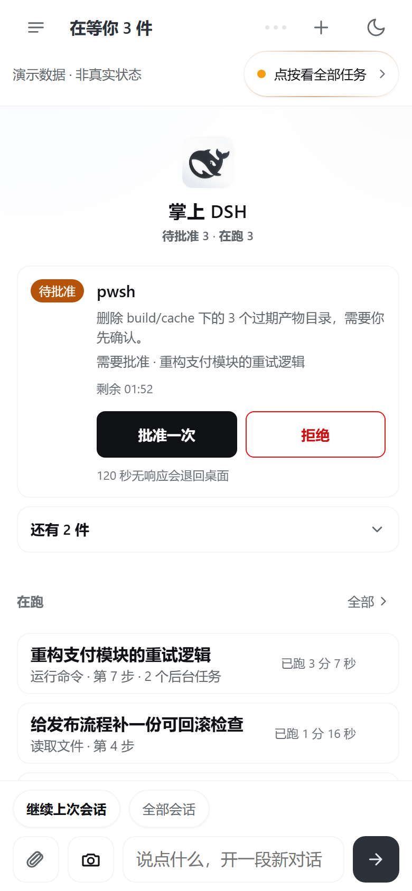

两件事刻意没做：**没有新写一套审批逻辑**（待办卡复用 v1.8.0 的按钮、二次确认与倒计时，只是多了一个放置位置），**断网时不清空首页**（继续显示上次读到的状态，底下补一条说明，而不是假装"什么都没有在等你"）。

### 并行视图：一屏看清、失败永远在最上面（v1.8.10）

首页「在跑」只有三条，开四五个会话就得一页页翻，失败的那条尤其容易被埋掉。v1.8.10 加了整屏的**并行视图**（首页「在跑」右上角「全部」，或抽屉里的「并行视图」），排序写死为一句话：

> **需要你（待批准 / 待回答） → 失败 → 运行中 → 已完成最近**

同组按最后活动时间倒序。这条排序不是"红的最显眼"，而是分组本身：即使把颜色全去掉，失败仍然在运行中与空闲之上，滑不到它才奇怪。每行只留四件事——标题（最多两行）、状态徽标、一句最新动作（工具名 · 第几步）、已运行 / 结束时长；失败行多一句 ≤60 字的原因和「查看」。有子代理的会话下面折一行「子代理 N」，展开就能看到它们各自的状态，不另开一层页面。

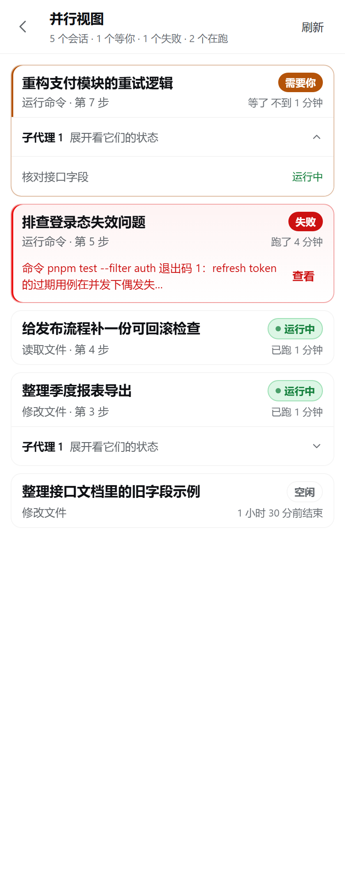

更新沿用现有的 5 秒轮询与 SSE：只按会话 id 复用行、改变化了的那几个字段，不整屏重建；页面不可见时时长计时与轮询一起暂停。390 宽首屏能看到 5 行，无横向溢出，标题两行截断。

### 手机端一次性审批（v1.8.0）

以前手机只能看「有 N 件事在等你」，真正批准还得回桌面。现在 `approval/request` 是 waterfall，插件可以**认领**它：手机页在线时，待批准卡片会多出「批准一次」和「拒绝」两个按钮。批准会弹一次「确认允许一次？」，拒绝不弹；倒计时结束或页面切走就自动退回桌面。

四条失败语义是这次的核心，功能本身反而简单：

- **没有手机在线 → 立刻 `next()`**。判据只看手机页最近 15 秒有没有轮询或审批 SSE；桌面 GUI 也打 `/taskwatch/data`，但不带 `view=phone`，故意不算在线，免得桌面开着面板却让审批空等。
- **超时 → `next()`**。`approvalTimeoutMs` 默认 120000，允许 10000–600000；越界取边界值并在启动时 warn。
- **`req.signal` abort → 立刻交还**，因为桌面端已经先处理了。
- **只暴露 `allowed-once` / `rejected`**，不做 always-allow；手机决定只成功一次，重复提交 409，过期或已交还 410。

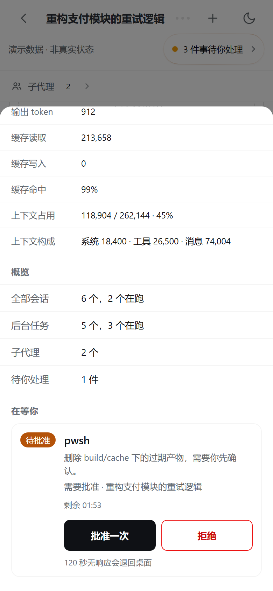

> 这张卡只在「手机在线且这次请求可认领」时出现；离线、超时、桌面先处理都会回到原来的「请在桌面端批准」。

### 手机端回答选项式提问与计划审批（v1.8.3）

P0 的第一类是「放不放行」，第二类是「选哪一个」。v1.8.3 把 `user-questions/request`
也接上了：它和 `approval/request` 一样是 waterfall，手机页在线时插件**认领**它，把题目
变成一张可点的卡。

- **单题**：选项渲染成整行按钮（`label` 一行、`description` 第二行小字），点一下即选中，
  但仍要再点「提交回答」—— 防的是误触直接交卷。
- **多选**：`multiSelect:true` 时按钮可以多选，底部同一个「提交回答」。
- **多题**：逐题纵排，答过的题不再显示「待回答」，没答完提交键保持禁用。
- **计划审批**：`intent.kind === 'plan-review'` 时标题带「计划审批」徽标，`intent.approve`
  对应的那个选项用主色强调（它不是"更推荐"，而是这次提问里唯一的放行项）。
- **自定义回答**：每题都有一个默认收起的输入框，展开后可以直接写一句话（≤2000 字）。
  提交时作为 `custom` 字段发给宿主。
- **一次性与倒计时**：与审批卡同一套 `mm:ss` 倒计时；到 0 显示「已退回桌面」。提交成功后
  卡片收起显示「已提交」；宿主回 `409` / `410` 时显示「已由桌面处理」；网络失败则保留
  已选项与自定义草稿、放开按钮让用户重试。

失败语义**逐条照抄审批**，没有第二套机制：没有手机在线 → 立刻 `next()`；超时（同一个
`approvalTimeoutMs`，默认 120000）→ `next()` 并审计 `by:'timeout'`；`request.signal`
abort → 立刻交还；任何内部异常 → `try/catch` → `next()`。审计同样只记
`{at, session, kind:'question', title, outcome, by, selectedCount, custom}` ——
**不记答案原文**。

这张卡在三个地方都能答，且是同一份结构：**首页待办区**、**任务详情抽屉**、
**会话页输入框上方的问答条**（只显示当前会话的提问）。

A phone client for DeepSeek Harness with **no app to install**: it reuses the desktop GUI's design tokens and adds a live metrics row above the composer.

### 设备列表与撤销（v1.8.7）

抽屉里多了一个「设备」：列出最近用过这个入口的手机与电脑，每行只有摘要名（系统 · 浏览器）、
最近活跃、从局域网还是公网进来，以及一个「撤销」。当前这台带「这台设备」标记；列表里的
id 是 12 位摘要，不是设备 cookie 原值。

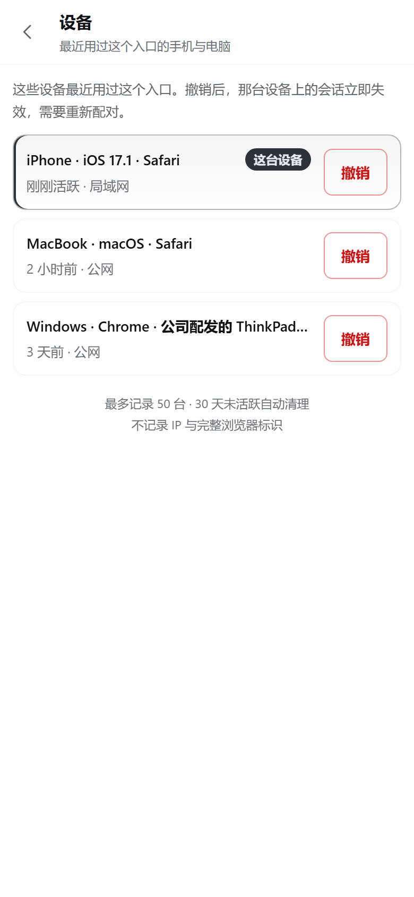

撤销**当前这台**要过一道二次确认，说清后果；确认后本端立即翻到「此设备已被撤销，请重新
配对」，下一次请求由宿主回 `401`：

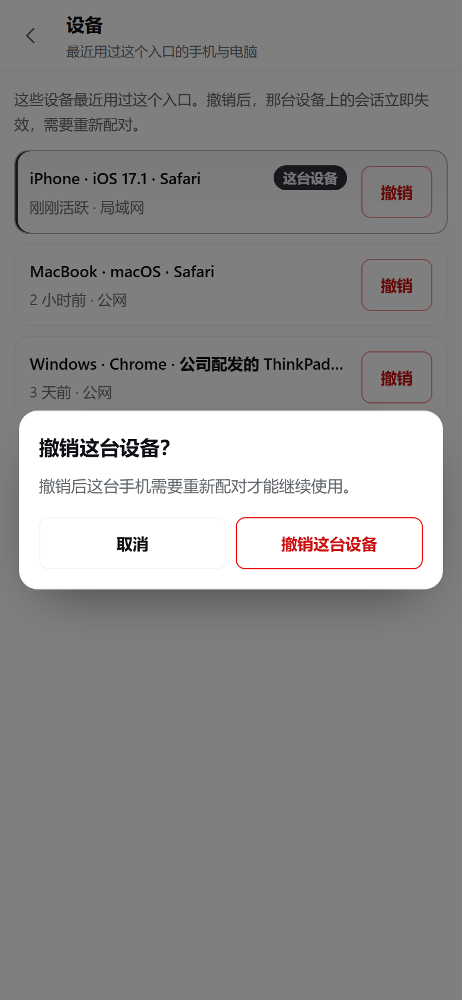

- 宿主给每个浏览器发一个 HttpOnly 的设备 cookie，页面读不到；**不记录 IP、不记录完整 UA**，
  最多 50 台、30 天不活跃自动清。
- 撤销别的设备不需要确认（一次点击即可），撤销自己才需要 —— 防的是手滑把自己踢下线。
- 这不是账号体系：本机仍然不鉴权，它解决的是「手机丢了 / 借人了，把这一台踢掉」。

### 高危动作二次确认（v1.8.8）

手机能批准之后，最危险的那一类不该和下一条普通改文案走同一个动作。v1.8.8 把判定放在
**宿主侧**：`approval/request` 到达时，`assessRisk({ toolName, reason, detail })` 用
`highRiskPatterns` 扫一遍宿主手里那几段可见说明，命中返回 `'high'`，页面只收到
`pending[].risk`。页面里**没有**任何按工具名或命令猜风险的正则 —— 它只负责画红色
「高危」徽标与第二步。

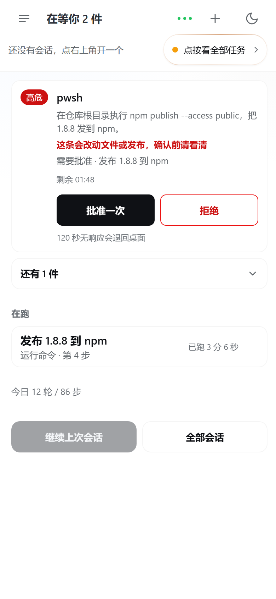

点「批准一次」不会直接发请求，而是在**卡片内部**展开确认层：列出工具与原因，写明
「确认执行？此操作不可撤销」，只有「确认执行」（实心危险色）才真的
`POST /taskwatch/approve`。展开期间卡片其余按钮禁用；「取消」、Esc、点遮罩都只收层、
不发请求。拒绝路径不加确认，直接发。

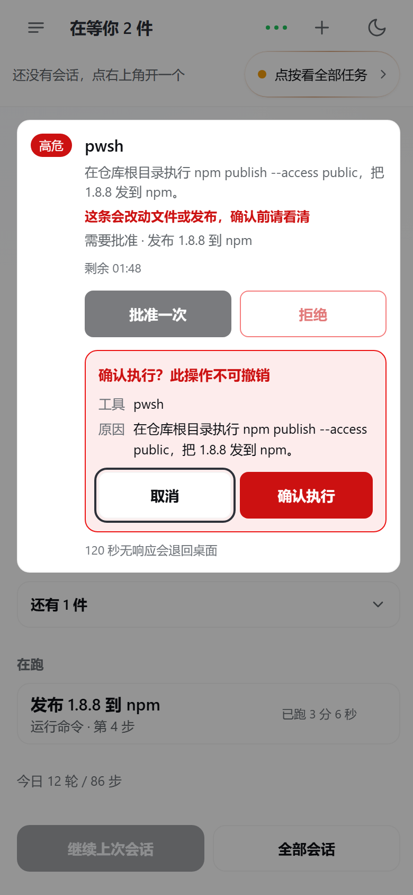

匹配对象是 `toolName + reason + displayReason` —— **不是完整命令**：我们本来就不存命令
全文（审计也不记），这是一道按可见信息加的门槛，不是命令级沙箱。默认模式 19 条：

| 类别 | 默认模式 |
|---|---|
| 命令类 | `rm -rf`、`Remove-Item`、`del /f`、`format`、`mkfs`、`shutdown`、`Stop-Process`、`taskkill /F`、`DROP TABLE`、`TRUNCATE`、`git push --force`、`npm publish`、`git tag -d`、`git reset --hard` |
| 路径类 | `.ssh`、`.dsh`、`C:\Windows`、`/etc`、`.git`（作为被操作对象时；`.gitignore` 不算 `.git`） |

`highRiskPatterns` 可以增删或整组替换（给了就替换默认值；最多 64 条、每条 ≤120 字符，
越界会被裁剪并在启动时 warn）。`riskConfirm:false` 只保留徽标、点击直接提交 ——
**关掉就失去这层保护**。

### 有事情等你时，推到飞书或微信（v1.8.15 / v1.8.16）

手机页要你主动看；会议里、路上、睡前，你不看就不知道有东西卡在那儿。v1.8.15 起宿主在
**有事情等你**时往外推一条：飞书群机器人，或者任何收 JSON / 表单的 webhook。v1.8.16 把
**个人微信**接成主通道：用 Server酱 把同一句摘要推到微信。配置全在手机上完成。

**推到微信（三步，v1.8.16）**

**1. 微信扫码登录 sct.ftqq.com。** 浏览器打开 `https://sct.ftqq.com`，用微信扫码登录 ——
这一步就是把「Server酱」这个公众号接到你的微信上。

**2. 复制 SendKey。** 登录后在页面上找到 SendKey（`SCT` 开头的一串字母数字），点复制。

**3. 在手机上粘贴，点测试。** 抽屉 →「通知」→ 类型选「Server酱（推到微信）」→ 粘
SendKey →「保存通道」→「发一条测试消息」。微信里收到公众号消息就算通了；失败会写
HTTP 码或原因，**不会回显 SendKey**。

**推到飞书（同样四步）**

**1. 在飞书里拿到机器人地址。** 建一个群（只有自己也行）→ 群设置 → 群机器人 → 添加
自定义机器人 → 复制它给的 webhook 地址（形如
`https://open.feishu.cn/open-apis/bot/v2/hook/…`）。

**2. 在手机上粘进设置页。** 抽屉 →「通知」→ 类型选「飞书机器人」→ 粘地址 →「保存通道」。

**3. 点「发一条测试消息」。** 走的是真实发送，成功会写「成功 · HTTP 200 · 0.4 秒」；
失败写 HTTP 码或原因，**不回显地址**。发不出去时不用猜，这一步就是体检。

**4. 然后它只在真的有事时响。** 批准请求与选项式提问出现时推一条；同一时间多件**合并成
一条**（`3 件事等你：…`），事情没处理完不会反复推。

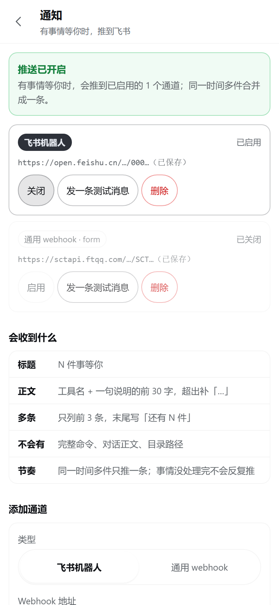

飞书地址与 SendKey 都**只存在这台机器上**：`~/.dsh/taskwatch-notify.json`，写完立刻收紧成
仅当前用户可读（POSIX `0600`；Windows 用 `icacls` 去掉继承、只授权当前用户，是
best-effort）。插件配置里**不收**这些凭据，仓库、日志、页面响应里都没有完整值 —— 页面只
显示掩码：飞书是 `https://open.feishu.cn/…/000…（已保存）`，Server酱 是 `SCT…abcd`。文件里
也**只存 SendKey**，不存拼好的 `https://sctapi.ftqq.com/<key>.send`。

正文口径是刻意的：`1 件事等你：pwsh · 删除 build/cache 下的…` —— 工具名 + 一句说明的
前 30 字，多条只列前 3 条并写「还有 N 件」。**不会有**完整命令、对话正文、目录路径。推送
本身也可能失败，所以发送超时 8 秒、最多 3 次（退避 1s / 3s），失败只在审计里留一行
`notify failed`，不影响手机页。

地址校验两条：只接受 `https://`；`http://` 仅放行 `127.0.0.1` 与 `10.` / `192.168.` /
`172.16–31.` 这类内网地址（方便自己起个转发）。所有通道都关掉时这个模块**完全静默**：
不排队、不发请求、不写日志。

**微信这条路要说清楚：** 个人微信没有官方 API —— 这条走的是 **Server酱 的公众号消息**，
摘要（工具名 + 说明前 30 字）**会经过它**。如果要完全私有，另一条路是**企业微信的应用
消息**（自建应用 / 群机器人，落点自己控制），这里不展开。

### 手机系统通知（Web Push，v1.8.17）

飞书与微信都要经过别人的服务器。手机自己就能做的事，不必绕：v1.8.17 用 **Web Push** ——
浏览器把订阅交给它自己的推送服务（Chrome 的 FCM、Safari 的 APNs），由**系统**把通知递到
锁屏。**不需要任何第三方账号，不产生费用**，运行时依赖依然为零。

**三步开起来（安卓 / 桌面）**

**1. 打开开关。** 抽屉 →「通知」→「系统通知」→「开启系统通知」，浏览器会问一次通知权限。

**2. 点「发一条测试通知」。** 它会走真实的加密与签名，锁屏上出现「测试通知」就算通了；
失败会写 HTTP 码（`410` 表示订阅已失效，会自动删掉，重新开启即可）。

**3. 之后只在真有事情时响。** 标题是 `N 件事等你`，正文就是上面那条摘要；同一时间多件
合并成一条，`tag` 固定，通知栏里不会叠成一列。点通知回到这个入口的首页。

**iPhone 要先「添加到主屏幕」**：iOS 16.4 起才支持网页推送，而且只对**从主屏幕打开**的
站点生效。Safari 底部「分享」→「添加到主屏幕」→ 从主屏幕打开掌上 DSH，再回到这一页就是
「开启系统通知」。用 Safari 直接打开时会看到这三步说明，而不是一个点了没反应的按钮。
更早的 iOS 收不到，页面里的待办照常。

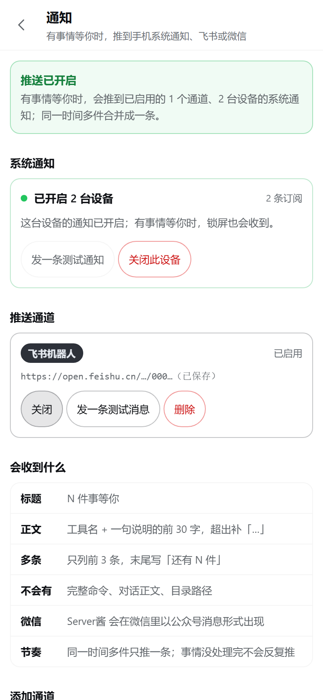

**三条边界是刻意的**

- **只出掩码。** 订阅文件是 `~/.dsh/taskwatch-push.json`（仅当前用户可读），每条记
  `endpoint` 与 `keys.p256dh / auth`；页面与接口只看到 `https://fcm.googleapis.com/…/AbCdEf`
  这种掩码（域名 + 尾部 6 字符）。完整 endpoint 与密钥不进响应、不进审计、不进日志。
- **绑在当前设备上。** 每条订阅记的是设备账本里的 12 位摘要（`twd` cookie 派生），
  不是 cookie 原值；撤销的设备不再推送。上限 20 条、单设备 5 条 ——「关闭此设备」删掉
  这台手机的全部订阅，别的设备不受影响。
- **算错不报错的东西要能证明。** 正文用 RFC 8291 的 `aes128gcm` 加密（ECDH P-256 +
  HKDF-SHA256 + AES-128-GCM，只用 `node:crypto`），`scripts/check-webpush.mjs` 拿
  **RFC 附录 A 的测试向量逐字节比对**，再用一条独立实现解密器跑往返（含中文与 4096 字节
  边界）；假推送服务会检查 `Authorization: vapid …`、`TTL: 300`、`Content-Encoding:
  aes128gcm` 并把正文解回标题与摘要。

VAPID 密钥在 `~/.dsh/taskwatch-vapid.json`（仅当前用户可读，**第一次需要时**才生成），
浏览器订阅绑的就是它的公钥；删掉这个文件等于让所有设备重新开启一次。

**要说清楚的两件事**：通知**经过浏览器的推送服务**（Chrome → FCM / Safari → APNs），
所以「不过第三方」指的是不经过额外的机器人或中转账号，不是不经过系统推送；通知的**正文**
只有摘要（工具名 + 说明前 30 字），不含命令、路径与对话内容。

### 拍一张直接发（v1.8.9）

拍屏幕、白板、错误码，比打字快一个数量级。相机键背后就是
`<input type="file" accept="image/*" capture="environment">`：手机上进系统相机，
桌面上退化成选图；没有 `getUserMedia`，也就没有权限弹窗和前后摄像头的状态机。

选中后立刻显示缩略图、大小和取消（×）。压缩在客户端做完再上传：长边压到 1600、
JPEG 质量 0.82；仍超过 2.5 MB 就降到 0.7 再试一次，还超就明说「图片太大」，不悄悄
上传一张 8 MB 的图去等超时。方向靠 `createImageBitmap(..., { imageOrientation:'from-image' })`，
竖拍的照片不会横躺（EXIF Orientation=6 在 `scripts/check-camera.mjs` 里有断言）。

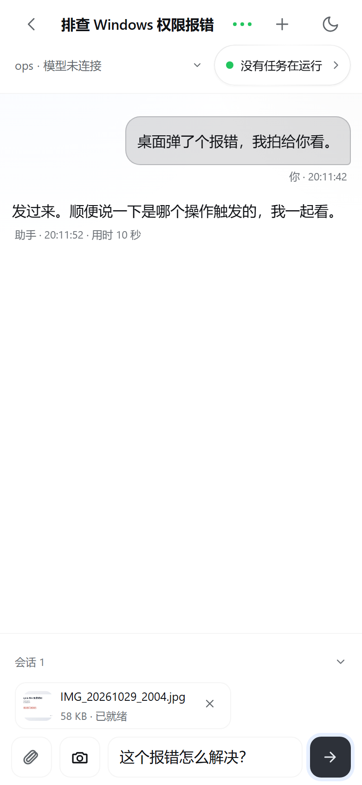

上传走的是**现有附件那条路**：同一个 `/taskwatch/chat/upload`、同一套进度与失败重试，
没有新增接口、存储或后端目录。照片不进云端 —— 它先落在本机的收件箱里，发给哪个会话
由你在这一页决定。附件与相机两个键都是 44px，390 宽实测输入框仍有 210px，页面不横向溢出。

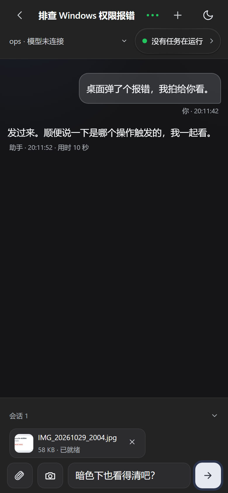

> 真机未验证的部分写在这里：iOS Safari 上 `capture` 的入口形态、HEIC 照片的输入，
> 以及弱网下 2.5 MB 图的等待体感，都只在 Chrome 里模拟过。

### 界面细节

真实会话里，连续的工具调用会折叠成一行「N 个步骤」，**失败的那一步永不隐藏**；助手回复支持轻量 markdown（标题、列表、行内代码、代码块），过宽的代码块提示可以横滑。

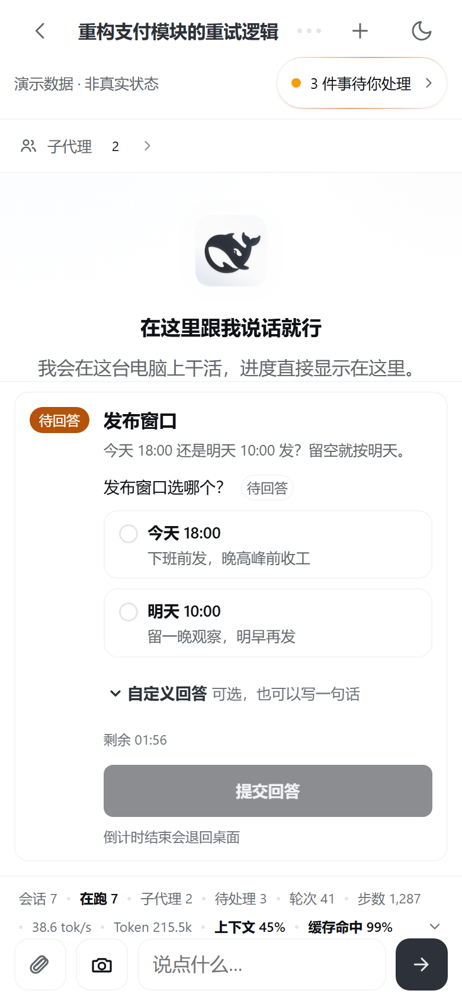

会话抽屉、状态卡片、输入框等全部走客户端同一套 design token，亮暗两套都是真值。抽屉里**工作台 / 操作在前**（开新会话、切入口、看设备都不用先滑过会话列表），搜索与**字号三档**紧贴在最下面的会话列表上方：

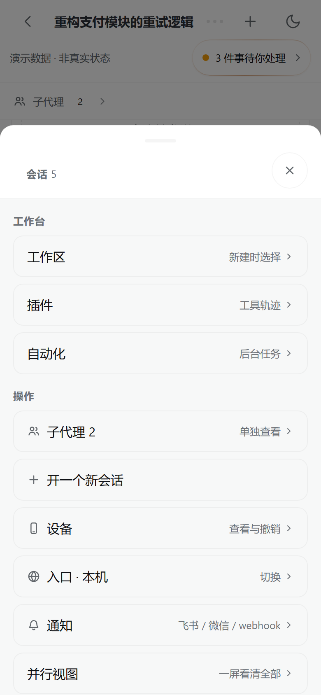

> 演示页由 `docs/demo.html` 渲染——那个文件是 `scripts/make-demo.mjs` 从 `lib/page.html` 生成的（`npm run demo` 重新生成），你可以直接用浏览器打开它，点着看，不需要装任何东西，也不会发出网络请求。契约测试会校验它与当前页面构建结果一致，防止它悄悄停在旧界面上。

抽屉「操作」区的最后一行是 **「给掌上 DSH 点个星」**。点它不会直接跳走，而是在抽屉里打开 GitHub 设备码授权面板：宿主申请一个 8 位码，你复制到 GitHub、用自己的账号确认，宿主才代你 `PUT /user/starred`。页面本身不接触 token，也不出现任何 GitHub API 域名；token 只在宿主内存里停留几秒，点完即弃。

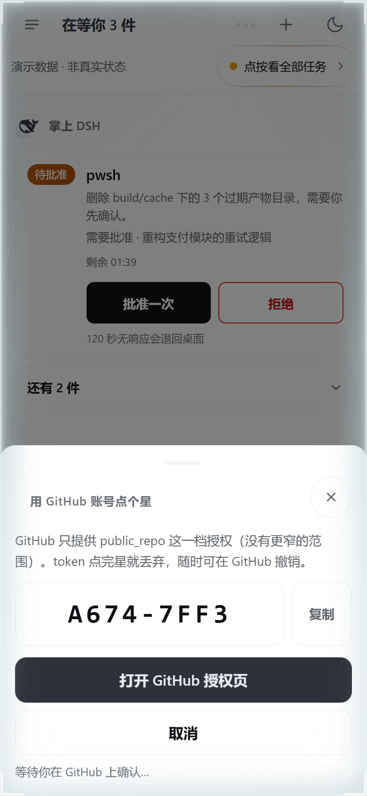

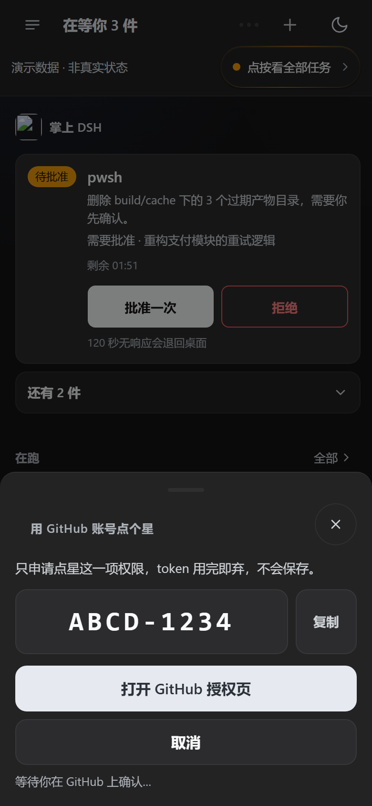

确认成功后面板变成「已点星 ✓」，只留一个关闭按钮：

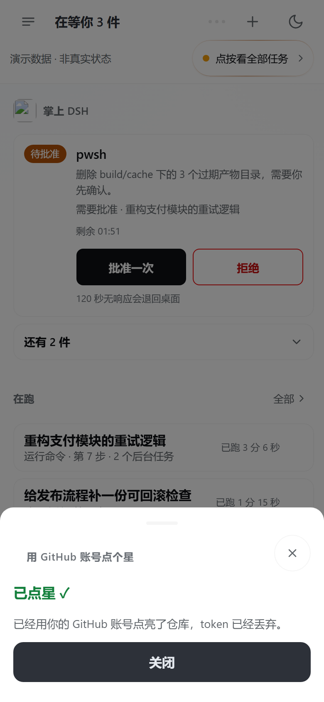

首次「允许一次」提交成功后，页面还会在那张卡下面出现一次轻量提示（8 秒淡出）；点过星或选择「不用了」之后就不再出现。

上面首页与审批这些图是 **v1.8.2 发布时用 `npm run shots` 重拍的当前界面**（真 Chrome + CDP、DPR2、390 宽；另有一张 360 宽），数据来自演示会话，图上保留「演示数据 · 非真实状态」的标记。首页 4 张（待办 / 深色 / 无待办 / 360）与「返回首页」1 张是那一版新加的；审批 4 张的审批状态是注入的，未在真实手机上点过。设备 2 张由 `scripts/shoot-devices.mjs` 在 v1.8.7 重拍；高危 2 张由 `npm run shots:risk` 在 v1.8.8 重拍（高清原图在 `_ui-review/round16/`，仓库里放的是同一张图）。相机 3 张由 `npm run shots:camera` 在 v1.8.9 重拍，数据是注入的演示会话与一张现画的报错屏（高清原图在 `_ui-review/round17/`）。会话抽屉由 `npm run shots:sheet` 在 v1.8.18 重拍（高清原图在 `_ui-review/round23/`）。首页品牌行（v1.8.20）由 `npm run shots:home-brand` 重拍，高清原图在 `_ui-review/round24/`；上面那组首页图仍是最初 v1.8.2 的界面。历史版本截图仍留在 `docs/screenshots/` 里，清单与用途见 [`docs/screenshots/README.md`](../screenshots/README.md)。

## 确认表单：`dsh-ui` 围栏（只做子集）

DSH 桌面端装了 [`dsh-genui`](https://deepseek-plugin.org/plugins/omdsh-dev/dsh-genui) 之后，助手回复里可以夹一个 `dsh-ui` 围栏（JSON 规格），桌面浏览器会把它画成可交互组件。**手机端现在也能渲染其中与「确认」有关的那部分**——不用回电脑点表单。

v1.8.25 起，本插件认领 `dsh-ui` 围栏，支持 6 种组件：

| 组件 | 手机上的样子 |
|---|---|
| `text`（`size`: display / h1-h3 / body / muted / caption） | 标题与说明文字 |
| `radio` | 单选项，整行可点 |
| `checkbox` | 多选项，整行可点 |
| `input` | 单行输入框 |
| `textarea` | 多行输入框（`Ctrl/Cmd+Enter` 也能提交） |
| `submit` | 汇总按钮，显示「已填 2/3」进度 |

- **组聚合**：`radio.group` / `checkbox.group` 只本地记录，**不逐次往返**；点 `submit` 时汇总成**一条**消息发回模型，格式与 dsh-genui 完全一致（`[genui-action] …` + `Component data: {answers, fields, total, answered}`），所以模型侧不需要为手机端做任何适配。
- **诚实交互**：`submit` 没写 `action` 就渲染成禁用态并给一行提示；`groups` 里的成员没填完时也禁用，不让「看着能点、点了没反应」。
- **不重复提交**：按「会话 + 围栏正文指纹」记账，提交后卡片置灰显示「已提交」，刷新也不会再发一次。
- **两种回退分得清**（v1.8.26 起）：围栏 `JSON` 本身坏掉 → 「dsh-ui 围栏解析失败，按代码块显示」；语法合法、只是手机端没有这个组件 → 「手机端不支持 table 这类组件，按原文显示」。**不让用户为我们的边界道歉**——这两种情况的错源不同，措辞也不该一样。
- **丢弃会说出来**：一张卡里只有部分节点不支持时，能画的照画，卡片底部加一行「已隐藏 1 个手机端不支持的组件：table」。静默丢东西对用户不诚实。
- **浮层不抢点击**：「回到最新」按钮遇到可点的表单控件会自动淡出（`.gu-clear`），不会盖住「确认并发送」。
- **坏规格不白屏**：`JSON` 解析失败、未知 `type`、超深嵌套都安全降级——能画的照画，画不了的丢弃，整段 JSON 一字不损地留在代码块里。

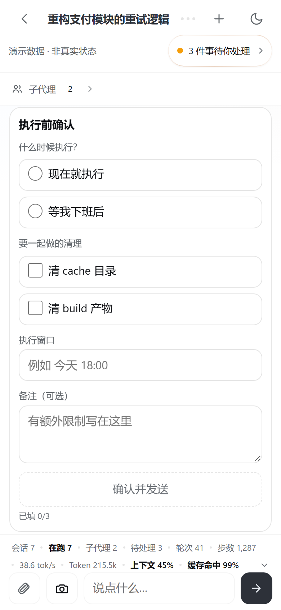

两类回退长这样（左：手机端不支持 `table`；右：同一张卡里只有表格节点不支持，正文照常显示）：

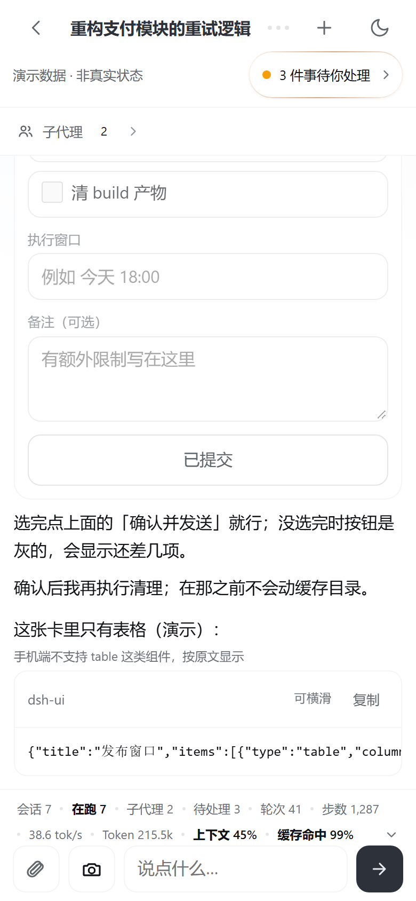

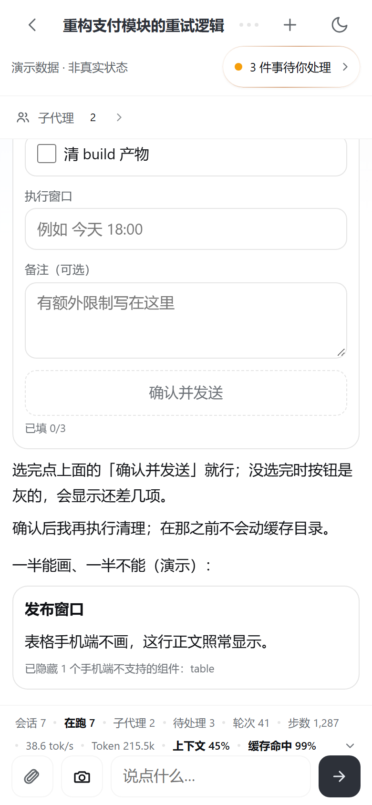

**不做什么**：判卷（`answer` / `explanation` / `quiz`）、图表、`mermaid`、`table`、`tabs`、`accordion` 一律不渲染（节点直接丢弃）。手机是窄屏、页面是零依赖单文件，这几块不划算——桌面端继续用 dsh-genui 全量渲染。也不做 `eval`：模型给的字符串只走 `textContent`，拼不进 HTML。

## 运行进度与简洁模式（v1.10.0）

### 运行条：说清「第几步 · 正在干什么 · 已经多久」

有任务在跑时，header 下多一条 44px 的行，三项信息：

- **第几步**：按本轮的 `step/start` 本地计数，`turn/start` 清零。切会话、`turn/end` 也清零——它描述的是"现在这一轮"。
- **正在干什么**：取最近一个**没有结果**的 `tool/call`，工具名照旧翻译成人话（`edit` → 「修改文件」）。有 `tool/result` 就说明那一步过去了，于是退成「等模型继续」。
- **已经多久**：本轮从 `turn/start` 起算。**由本地 1 秒计时器刷**（`tickDurations`），不等网络；首页「在跑」区的「已跑 N 分」也走同一个计时器。

**为什么不画进度条**：宿主的事件里只有"第几步"，没有"一共几步"。没有分母还画一条 60%，是在编数字。宁可只说"第 4 步 · 已跑 1 分 37 秒"——这两件事都是可核对的事实。

点颜色也跟着语义走：运行条的点是**琥珀**，和工具卡「进行中」同一个颜色；绿色只留给真正结束的状态。

### 简洁模式：收起的是信息密度，不是能力

抽屉 →「显示设置」→ 简洁模式（`localStorage['tw-simple']`，**默认关**）。

| | 关闭（默认） | 打开 |
|---|---|---|
| 指标行 | 输入框上方两行数字 + 点开的明细 | 不显示（`html.simple` + CSS，不删节点） |
| 附件 / 拍照 | 两个 44px 的键 | 合并成一个「+」，点开是**拍照 / 选图片 / 导入文件**三项 |
| 空队列提示 | 「正在运行 · 队列为空」占一行 | 不占行；真排上队了照常出现 |
| 输入框与发送 | 不变 | 不变 |

只切 `<html>` 上的一个类：不刷新、不重载数据、不改任何 JS 状态，所以开关是瞬时的，360 宽也不折行（`check-simple` 钉着这条）。默认关是刻意的——它是一次界面行为的改变，不该因为升级就替所有人生效。

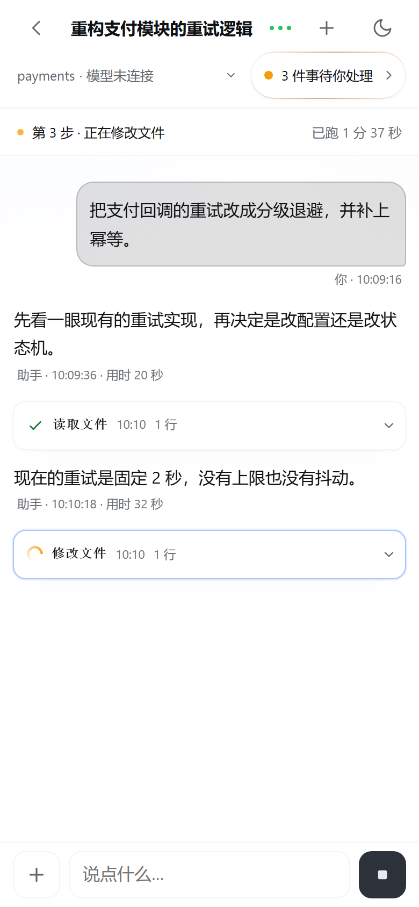

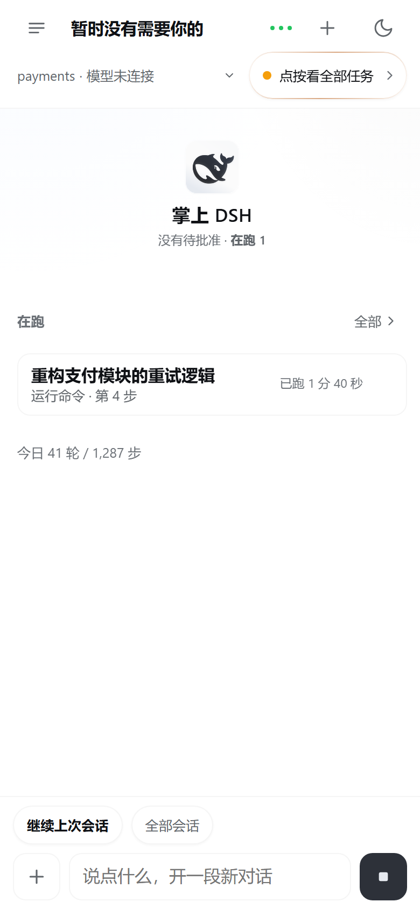

### 连接诊断：给"为什么老在重连"一个能读的答案

抽屉 →「连接诊断」，一屏五行：状态轮询（上次成功 / 连续失败 / 几秒后重试）、会话事件流（已连接 / 断开 N 秒 / 本次重开几次）、审批事件流（已连接 / 已停用 + 原因）、最后一条事件多久前、中继能力（版本 + 能力数）。底下是「立即重试全部连接」，和页脚那条一键重试走同一个入口。

这一屏只读：不改状态、不上传东西。**手机切网、锁屏回来、远端突然不动时先看它**，比猜"是不是网络不好"有意思得多。
