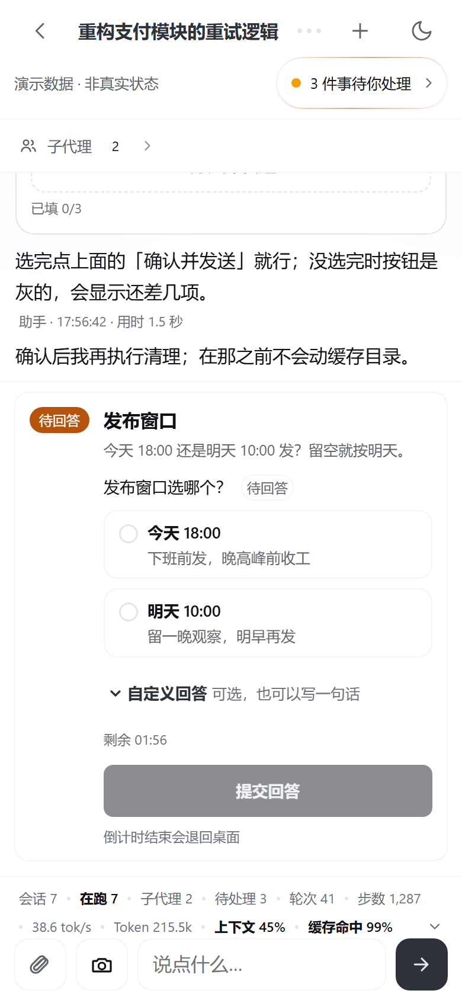
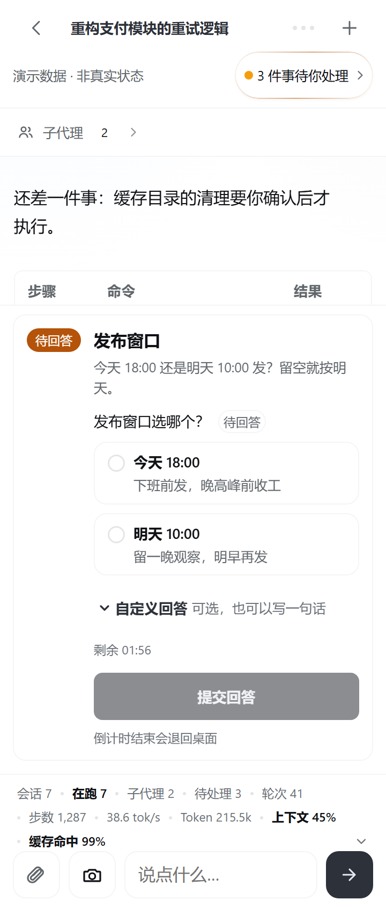

# 页面实现笔记

> 手机页为什么这样排、为什么不做整页重建、断网与采集失败怎么处理，以及几个只有端到端跑一次才会露出来的坑。
>
> 这一篇是从 [README](../../README.md) 拆出来的：内容与当时实装一致，只搬了容器、修了相对路径，没有改写。

[回到 README](../../README.md) · [文档索引](../../README.md#文档)

### 排队、重排与「立即发送」的真实语义

宿主本来就有两条投递通道：`mode:'queue'`（进 `nextTurn`，等下一轮）与
`mode:'steer'`（进 `nextStep`，在本回合下一个步骤边界被领取）。手机端：

- **排队** = 默认的 `queue`；`GET /taskwatch/chat/queue` 读 `nextTurn` 的顺序，
  `POST /taskwatch/chat/queue/reorder` 用同一批 Message 整体重新 `splice`，
  不伪造消息、不改内容。
- **立即发送** = `send` 带 `now:true`，即宿主原生 `steer`。它进入 steering lane，
  排在本轮所有 `nextTurn` 排队消息之前，**但不会中止**正在执行的工具调用或模型
  请求 —— 消息在下一个 step 边界才被模型看到；会话空闲时会立刻唤醒并起一轮。
  同一 lane 里更早的 steering 消息仍按先来后到排在它前面。
- **硬打断** = 再带 `interrupt:true`：先 `cancel({keepInbox:true})`（队列保留），
  等 agent 真正 idle（最多 2 秒）再 steer；成了就先于保留的 `nextTurn` 队列执行
  （cancel 前已有的 steering 仍按原顺序先跑）。2 秒内停不下来返回
  `409 interrupt-timeout`，消息不发出、队列不动。
- **不会**做的事：不把队列顺序存在插件内存里（那会和宿主真实队列漂移），
  也不支持把 `steering` 消息重新排进 `nextTurn`。

### 手机能选工作区，但选不了任意目录

「在手机上新开一个对话」得能指定在哪个目录开工，否则只能落在部署默认值上。但
`sessionController.create()` 收的是绝对路径（`cwd` / `workspaceId`）—— 直接透给公网
客户端，等于把宿主的磁盘交出去。所以拆成两件事：

- **选择权给手机**：`GET /taskwatch/chat/workspaces` 回候选清单，页面只负责挑；
- **决定权留服务端**：`POST /taskwatch/chat/create` 拿客户端发来的字符串去清单里
  **逐字比对**，命中才写进 `cwd`，否则直接报错。

清单三个来源：现有会话的 `cwd`（你最近在哪儿干活，天然是你自己认过的目录）、
环境变量 `DSH_TASKWATCH_WORKSPACES`（`;` 分隔，默认 `D:\Projects`，装到别处改它）、
固定候选。不存在的目录用 `statSync` 过滤掉 —— 手机上少一个点进去才报错的入口。

### 对话路由为什么这么薄

手机端要的「像 ChatGPT 一样对话」，DSH 内部**本来就有** —— `sessionController`
提供 `prompt` / `follow` / `cancel` / `list` / `create` / `page` / `modelCatalog` /
`selectModel`。所以这个插件一行 LLM 调用、一行流式解析都没写，只是把这几个方法
转成 HTTP。三个实测出来的坑记在这里：

- `follow()` 返回的本来就是**为传输设计的 wire 帧**（`SessionWireEvent.data` 是
  `JsonValue`），可以安全地逐帧 `JSON.stringify`；不要去碰会话活对象。
- SSE 响应必须显式带 `x-accel-buffering: no`，否则 nginx 会把流式缓冲成一次性吐出。
- `tool/result` 帧的 `callId` **不在顶层**，在 `data.message.source.callId`。
  按顶层读会一直拿到 `undefined`，表现是每来一个工具结果就多插一张错卡。
- 会话标题只能从事件日志的 `session/title` 帧里取 —— `SessionSummary` 里**没有**
  title 字段。分页语义也是实测的：`throughSeq` 超过会话 cursor 会报
  `past cursor N`，而 N 正是需要的值，于是用错误信息一步重试。

### 交付文件为什么按内容识别，而不是按扩展名

手机端要能**直接看到**交付的图和 PDF（而不是只收到一个文件名），所以加了一条只读的
`/taskwatch/file`。它的安全边界抽在 `lib/files.js` 里，配 75 项边界测试：目录穿越、
同前缀兄弟目录、白名单外路径、realpath 复查（防符号链接逃逸）、`.svg`/`.html`/`.js`
一律拒绝。

v1.8.1 起，带 `sessionId` 的路径请求可以读**本会话消息正文里引用过的绝对路径**
（这是经用户 2026-10-29 授权的放宽，边界见 [安全边界](security.md)）；不带 `sessionId` 的
旧调用行为完全不变，仍然只认那两个根目录。

一个真实验收抓到的教训值得写下来：宿主附件库是**内容寻址**的，模型产出的图落在
`~/.dsh/attachments/v1/objects/<hash>` —— **名字就是哈希、根本没有扩展名**。
最初只按扩展名判类型，于是最常用的那条路（"把刚生成的那张图发我"）被判成
`unsupported-type` 直接 403。而演示页一切正常，因为它用的是 data URI 和有扩展名的
路径 —— 这类「演示绿、真机红」的差异，只有端到端跑一次才会露出来。

现在：有扩展名走快路；没有扩展名就读前 16 字节按魔数识别（PNG / JPEG / GIF / WebP /
PDF / ZIP / MP4）。这是**按内容识别**，不是"按内容放行" —— html / svg / js 没有魔数，
仍然走不通，白名单没有被放宽。

### 手机页的动效为什么这么克制

第 10 节「纸墨微动」：静态是一张纸，动起来像墨。位移 ≤3px、时长 120–320ms、
曲线统一"起步快、末段收"，**每个动效都携带信息** —— 在跑 = 一圈墨环在转、
完成 = 勾自己画出来、失败 = 顿一下、图 = 骨架纸纹后显影、新消息 = 浮标弹一下。
不放光、不放烟花、不为动而动。

两条硬约束写进了契约测试（不靠肉眼）：

1. **入场动画必须由 JS 按"状态刚刚变化"加的类门控**。挂在会被整段重渲染的节点上，
   每 3 秒轮询就重放一次，观感从"灵动"变"抽搐"。
2. **"隐藏"只能挂在 JS 之后加的类上**。先藏内容、等 JS 显示是这类动效最常见的自伤：
   JS 一旦不跑，图片就永远看不见。

缩小动效时也不是简单全关：墨环变成静态描边、骨架图直接可见 —— 动效可以没有，
状态语义不能丢。

### 手机页为什么这样排

要解决的是「小白点进来也看得懂」。所以页面**不做仪表盘**：顶部一行说人话的状态
（点开才是原来那张数据表），中间是对话，底部是输入框，数据表格收进抽屉。

两个具体决定：

- **工具调用翻译成人话**。`pwsh` → 「运行命令」、`grep` → 「搜索内容」、`subagent` →
  「派发子任务」。用户不需要知道 `pwsh` 是什么；卡片上还给一行命令/路径摘要，状态用
  进行中 / 完成 / 失败三态。这是"看得懂进度"最关键的一处。
- **逐字输出只改一个节点**。整页重建会让长会话每来一个字都重排一次。

### 对话排版与子代理二级页（v1.7.6）

手机只有 360–390px 宽，对话里最容易坏的是三样东西：表格、长代码、长 URL。v1.7.6
把表格渲染成真表格并放进可横滑的 `.tablewrap`，代码块自己横滑，长 token 在分隔符后
断行；页面级 `scrollWidth` 在 390 和 360 下都等于视口宽。助手正文、流式回复和工具卡
统一 100% 宽、左对齐；用户消息仍靠右。

子代理不再混在主对话里：工具条出现「子代理 N」，点进去是独立列表，再点开只读快照；
返回回到原来的根会话。没有子代理时入口不出现。

长代码块提示「可横滑」，自己滚，不把页面撑宽：

子代理不再混在主对话里：工具条出现「子代理 N」，点进去是独立列表，再点开只读快照；
返回回到原来的根会话。没有子代理时入口不出现。

360 宽下最难的表格与超长 URL 也不横向溢出：

截图是 `docs/demo.html` 的真实渲染（Chrome headless + CDP，DPR2，390 / 360 宽），
数据来自演示会话。回归自检：`npm run check` 里的 `scripts/check-mobile.mjs` 会在
390 / 360 两个宽度下跑 `window.twSelfCheck()`、切会话残留断言与左基线断言。

### v1.7.7：坏图不再留空框、图标不再依赖字体

图片加载失败（宿主文件路由默认只服务 `~/.dsh/attachments` / `~/.dsh/outbox`；v1.8.1 起
本会话引用过的绝对路径也可读，其它路径仍是 403；外域 URL 也可能不可达）时，v1.7.6 会铺
一张 63px 的整宽 ERR 卡片，视觉上仍是一块把正文截断的占位框。v1.7.7 换成 36px 单行提示条，
并且页面级保证 DOM 里**不留破图 `img`**。v1.8.1 起提示条会区分「该文件未被本会话引用」与
「文件超过 50 MB」，文件卡片第二行同样按 403 / 413 分开写，并保留可点的原路径。

会话抽屉里「子代理 N」入口的图标改成内联 SVG（不再用字符，真机上曾出现「廿」这种回退字形）。

> 这一版的「改前 / 改后」对比图仍留在 `docs/screenshots/v1.7.7-broken-before.png` /
> `v1.7.7-broken-after.png` / `v1.7.7-subagents-icon.png`，只作历史留存，README 不再引用；
> 当前界面看 `docs/screenshots/current/`。

### v1.7.8：长会话不再整屏闪、附件信封不再露标签

图片的骨架流光用 `inset:0` 绝对定位，却忘了给 `.md-imgwrap` 定位，包含块一路退到**视口**。
长会话里总有还没进入视口的懒加载图，它们永远带着 `.loading`，于是整屏多出一条 1.35s
无限循环的亮带（用户原话「反复闪屏」），`translateX(55%)` 还把页面从 390 撑到 601。现在
流光被关进图片盒、不吃点击，离屏图也不再挂任何动画：

- 同一条会话的 `scrollWidth` 从 **601 → 390**，静止 1.4s 内像素变化 2.55% → 0.1%。
- 同一轮的第二个修复：DSH 给模型看的 `<path>…</path><type>image</type><content>…</content>`
  信封，以前在手机上原样显示成 XML（某会话第一条消息整条都是它），现在渲染成图片卡，
  拿不到图时仍是那条 36px 提示条。

> 这一版的「改前 / 改后」对比图 `docs/screenshots/v1.7.8-flash-before.png` /
> `v1.7.8-flash-after.png` 只作历史留存，README 不再引用。

### v1.8.27：附件只送 id 读不到，完整 ref 要原样带回去

同一位真机用户报的第二个问题：手机会话里的图片位置只显示「这份内容现在读不到了 · 打开原图」，
桌面同一批图正常。

宿主的 `readImage` / `readFileStream` 除了校验字节完整性，还会拿 ref 里的 `mediaType` /
`bytes` / `width` / `height` 跟**探测到的真实元数据**逐项比 —— 只送 `attachmentId` 时这四项是
`undefined`，必然不等，于是稳定 404。页面解析消息附件时本来拿到了完整 ref，却只留了 id 和名字。

现在页面把完整 ref 用 `&ref=<JSON>` 带回去，服务端只收白名单字段（`name` / `mediaType` /
`bytes` / `width` / `height` / `kind` / `sha256`），`attachmentId` 强制用 URL 里的 id，再交给
宿主去校验；`ref` 坏掉或循环引用时退回只送 id，不让一条消息整条崩。图片与文件两个分支都改。

`check-files` 里新增的一组就是这条路的端到端测试：起真实 `node:http` 服务 + 按宿主源码语义写的
附件服务替身（真实 PNG 字节、真实头部探测），断言「只送 id → 404」「带完整 ref → 200 且字节
逐字节相同」「ref 里伪造 id 顶不掉 URL 的 id」「额外键不往下传」「坏 JSON 不 500」。

### 页面为什么不做整页重建

页面每 3 秒轮询一次，但**数据没变就完全不碰 DOM**，只刷新右上角时间戳。首版是
`root.innerHTML = h` 全量重建，结果是每 3 秒把页面拆一次：展开的东西 3 秒后被抹掉，
滚动位置被打断，看起来像「不刷新」和「点不动」——那是同一个原因。

这里有个容易漏掉的坑：**比较序列化结果时不能把 `generatedAt` 算进去。** 它是每次采集
都不同的 `Date.now()`，带着它比较，签名就永远在变，「数据没变就不碰 DOM」实际上是
一句空话，页面照样每 3 秒整页重建。所以客户端算签名、服务端算 `ETag` 时都先把这个
字段归一化，两边保持同一套判据。

而「有东西在跑的时候」仍然要重画：画面上的时长要一直往上走。所以静止时就真的不碰
DOM，有运行中的会话、后台任务、子代理或工作流时才重画。

展开状态与对话缓存存在 JS 对象里，跨轮询保留；点击用事件委托挂在常驻容器上，
所以内层 DOM 重建也不会丢监听。对话按需懒加载，点开一次即缓存。

### 轮询在服务端和手机上各收一次口

页面每 5 秒轮询，而这个页面的主要用途是**手机**——最常见的状态是「揣在兜里、屏幕已熄」。
不处理的话，一个常驻后台的标签页会永远每 3 秒发一次请求。所以两头都做了收敛：

- **客户端**：监听 `visibilitychange`，页面隐藏时 `clearInterval` 停止轮询，回到前台立刻
  补一次请求。手机上省的是流量和电。
- **服务端**：`snapshot()` 一次要问一圈服务（每个 agent 的 jobs、每个会话的
  `eventAt`/`title`/`goal`、每个 agent 的 `listDescendants`）。现在同一份采集在
  **2 秒 TTL** 内被复用，并发请求共用同一个 Promise 而不是各算各的——手机、桌面面板和
  多个标签页同时开着时，这一层把开销从「每请求一次全量采集」压成「最多每 2 秒一次」。
- **带宽**：`/taskwatch/data` 返回 `ETag` 并在未变化时回 `304`，手机上只交换一个头而不是
  整份 JSON。

最后一条有个**必须成对**的地方：页面取数用的是 `cache:'no-cache'`，不能用 `no-store`。
`no-store` 会让浏览器根本不保存响应，也就永远不会带 `If-None-Match` 回来，服务端那段
`304` 会变成死代码。这两处因此都在契约测试里钉住了。

### 网络抖动时会发生什么（v1.8.4）

- **页面在后台就不刷屏**：`visibilitychange` 一隐藏就停掉轮询、暂停所有重连排期，锁屏十分钟不会攒出一串请求。
- **断线后按退避重连**：快照和两条事件流共用 1s → 2s → 5s → 10s → 30s（每档 ±20% 抖动、30s 封顶）的退避，同一时刻只允许一个 `/taskwatch/data` 在飞。
- **恢复后自动续上**：`online`、回到前台（以及 iOS 的 bfcache `pageshow`）都会立刻取一次新快照并重开事件流；超过 3 个轮询周期没成功，页脚显示「连接已断开 · 正在重试（N 秒前成功）」并给一键重试，**旧内容不会被清空**。

### 采集失败时不能伪装成正常

这是监控工具最危险的失败姿态，所以单独说清。

宿主采集异常时 `/taskwatch/data` 回的是 **HTTP 200 + `{ "error": ... }`**。如果客户端
把这份载荷当数据用，画出来就是一块「全部为 0」的板子：0 个会话、0 个后台任务、
「当前没有等待中的审批或提问」。**它看起来像「真的没有任务」，而不是「没读到」。**

所以两半都显式处理 `error` 字段，把它当错误而不是数据：

- **手机页**：`tick()` 先查 `d.error`，命中就只在页脚写「采集失败：…」并保留上一份
  可用快照，绝不拿它去重画。
- **GUI 面板**：把 `snap.error` 视为错误，继续渲染**上一份可用快照**，并在顶部挂一条
  「数据可能已陈旧（快照时间 HH:MM:SS）：…」的横幅。一次网络抖动同样只产生这条横幅，
  而不是把整块面板清成空白 —— 监控面板的价值恰恰在于「断开时还能看到最后一帧」。

同一类问题的另一面是轮询的**乱序**：并发请求下，较早发出的响应完全可能晚回来。两半
都用一个自增序号只接受最新一次的结果，避免旧数据覆盖新数据。

### `/taskwatch/session` 的两条限制

1. **只能读活着的会话。** `ctx.sessions` 是内存存储，`get(id)` 返回 `undefined` 时接口
   会**明确报错**「这个会话不在内存里（已落盘但未加载的会话读不到）」，而不是返回一个
   空的 `messages` —— 后者会让人误以为那个会话真的没说话。
2. **只读不写。** 没有发送消息、批准审批、打断运行的入口。要做到那些，必须把 DSH 的
   Web GUI 暴露出去，那是另一个量级的风险，本插件刻意不做。

消息只取叶子字段（role、text、工具名、时间），不把活的会话日志对象序列化出去。

## GUI 面板

`lib/client.js` 注册一个侧边栏面板（`sidebar.panellist`），数据取自同源的
`/taskwatch/data`，**不需要任何 host RPC**。样式全部挂在插件自己的 fiber 上，
卸载即还原。

面板右上角有一个指向手机页的链接，方便直接把 `/taskwatch` 复制到手机上打开。

面板和手机页在轮询上是对称的：窗口不可见时 `clearInterval` 停止轮询，回到前台立刻
补一次请求。桌面这一半容易被忽略，但它的典型用法恰恰是「GUI 最小化、拿手机看」。

## 连接稳定性（v1.10.0）

远端"一直在重连、记录不是实时"是三件事叠出来的，修法各自独立：

1. **心跳**。`/taskwatch/chat/stream` 每 12 秒写一条注释帧 `: ping`（`lib/index.js`）。
   移动网络、SSH 隧道、反代都会把长时间没有字节的连接当死连接掐掉（nginx 默认 60s），
   而模型思考与长工具调用之间本来就可能几十秒没有新帧。注释帧不改变任何客户端状态，
   只是让中间那些设备看见"这条连接还活着"。审批流原本就有 20 秒一条。
2. **重连不重画**。重连拿回的快照常常和上一份**内容相同**（`cursor` 未变）：
   `applySnapshot` 这时直接返回，只同步标题。以前是无条件 `S.items = []` + `renderAll()`，
   于是每次重连都整屏重建——滚动位置、展开的卡、正在读的那一段全被打断，
   用户看到的就是"内容在跳、不是实时的"。
3. **「重连中」分档**。事件流断开不足 5 秒不翻黄（手机切网常几百毫秒就回来）；
   首次连接显示「连接中」而不是「重连中」；超过 5 秒才写「断开 N 秒，正在重连」。
   `S.esDownAt` 记断开起点，`netStatus()` 只读它。
4. **审批流不空转**。中继能力表（`/taskwatch/lan.json` 的 `capabilities`）里没有
   `approvals-stream` 就不开这条连接；开了连续 4 次失败也停（`makeLink` 的
   `maxFailures` / `ongiveup`）。审批数量本来就有 5 秒轮询兜底，不需要为它保留一条
   永不成功的连接。

配套的两个观察手段：

- **本地秒表**（`tickDurations`）：所有「已跑多久」只由这个 1 秒计时器刷新，
  数据没变、只是刷新方式不同。页面隐藏时停掉，回来再开。
- **连接诊断**（抽屉）：三条链路各自的状态 + 最后一条事件 + 中继能力，只读。
