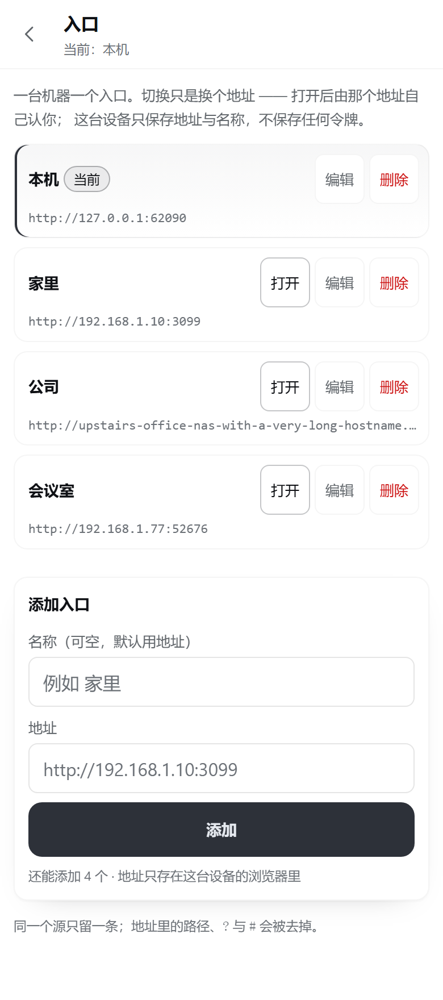

# 远程入口：部署、连接原理与换路票据

> 公网一条路、局域网一条路；谁签票、谁兑现、6 位码管哪一段；502 从哪一层来。
>
> 这一篇是从 [README](../../README.md) 拆出来的：内容与当时实装一致，只搬了容器、修了相对路径，没有改写。

[回到 README](../../README.md) · [文档索引](../../README.md#文档)

## 手机上怎么打开（不用装 App）

1. 在跑 DSH 的电脑上启用本插件，让它监听一个本地端口（见下文各章节）。
2. 电脑侧起一个**反向隧道 / 中继**，把那个端口映射到一个 **HTTPS** 地址。
   PWA 的 Service Worker 只在 **HTTPS（或 localhost）** 下工作——纯 HTTP 能看页面，
   但装不到手机桌面，也没有离线壳。
3. 手机上打开那个 HTTPS 地址，首次用一次性**配对码**换一个长期令牌，之后自动续期。

### 加成一个伪 App（主屏幕图标）

浏览器地址栏里的那一页，**加到主屏幕之后就变成一个有图标、独立全屏的入口**：点开不再有地址栏，切换手势、状态栏样式都按 App 走。技术上它是 PWA，不是原生 App，也不经过任何应用商店。

- **iOS Safari**：分享 ⤴ → **添加到主屏幕** → 添加。图标来自页面的 `apple-touch-icon`，名字来自 `apple-mobile-web-app-title`（现在是「掌上 DSH」）。
- **Android Chrome**：右上角 ⋮ → **安装应用**（旧版菜单叫「添加到主屏幕」）。v1.7.9 起站点有了 web app manifest，`display: standalone`、`start_url` / `scope` 都是 `/taskwatch`，装完是**独立窗口**，不是带地址栏的快捷方式。图标复用页面同一个 `/taskwatch/icon-192.png`。

两条硬前提，先说清楚免得白试：

- **必须是 HTTPS**（或 localhost）。局域网那条 `http://<电脑的内网 IP>:3099/taskwatch` 页面照常能用，但**装不成**桌面图标、也没有离线壳 —— 想装就走公网中继那条 HTTPS 入口。
- **iOS 的 PWA 没有后台推送，也没有真正的后台刷新**。退出后轮询就停了，重新点开才会继续；这一点和原生 App 不一样。

> 反代与隧道属于部署细节，本仓库只负责 DSH 这一侧：域名 + nginx + `ssh -R` 可以，
> Tailscale、Cloudflare Tunnel、ngrok 之类同样可以（它们都能免费给出 HTTPS）。
> **自己的专属入口链接里带访问令牌，等于完整控制权，绝不要提交到本仓库。**

### 多台机器 / 多个入口（v1.8.12）

家里一台、公司一台、会议室那台测试机——以前每换一台就要重新输地址、在手机里再配一次。现在手机页里有一份**入口清单**：抽屉里的「入口 · 当前名」点开就是切换器，每行一个名字 + 地址，点「打开」就在新页面跳到那台机器的 `/taskwatch`。

- **切换只换地址**：认证靠**每个源各自的 cookie**（`tw` / `twd`），浏览器只会把 cookie 发给发下它的那个地址。所以切过去那台机器自己就认你，不需要在手机里再存一份令牌。
- **手机上不存令牌**：清单只有 `{label, url}` 两项，写在 `localStorage['tw:entries']`；不存 token、cookie、配对码。拿到这份清单最多知道几个内网地址。
- **最多 8 条**，同一个源只留一条；地址会被规范化成「协议 + host[:port]」——路径、`?`、`#` 丢掉，`javascript:` / `data:` / `file:` 一律拒绝。
- 首次进入自动加一条「本机」（当前地址）；已经删空的清单不会又被自动加回来。
- 当前项只做一条细线 + 极淡底色，不抢眼；390 宽、明暗两套、命中区 44px。切换**不清 cookie**，也不做跨源取数（浏览器同源策略不允许，也不该绕）。



## DSH Web 端口固定为 3080（部署前提）

中继的上游默认就是 `http://127.0.0.1:3080`（`server.mjs` 里的 `RELAY_UPSTREAM`），
所以 **DSH 的 Web 端口必须是 3080**，否则 `/taskwatch/data` 只会回 502，手机页显示
「对话功能不可用」。桌面版默认不是这样：端口由 `app.asar` 决定，而那里把 `--port 0`
写死了（OS 每次启动随机挑一个空闲端口），并且 **没有** `DSH_PORT` / `DSH_WEB_PORT`
这类环境变量入口、配置文件里也没有端口字段 —— 环境变量与 CLI 参数这条路在桌面版上
都是堵死的。

唯一「不改安装目录、升级不丢」的入口，是用户补丁层覆盖 web-app 自带的 `webserver` 行：

```yaml
# ~/.dsh/profiles/desktop/cordis.patch.yml
- id: webserver
  name: "@deepseek-ai/dsh-host-webserver"
  config:
    host: "127.0.0.1"
    port: 3080                  # 原来是 !!js ctx.webStartup.port ?? 3080，桌面版传进来的是 0
    tls: !!js ctx.webStartup.tls
    compression: gzip
    compressionLevel: 1
    compressionThresholdBytes: 1024
```

三个要点：

- 补丁层是**整段替换** `config`，不是深合并。少写一个字段（上面那四个除 `port` 和
  `host` 之外的字段）等于把它删掉，所以必须原样写回。
- 这个 profile 的补丁文件是 **live** 生效的：保存后 DSH 立刻在新端口重新监听，
  已经打开的窗口会断线 —— 重开一次客户端即可，会话不丢。
- **改端口时三处必须一起改**：上面这行 `port`、`~/.dsh/autostart/services-watchdog.ps1`
  里给中继设的 `RELAY_UPSTREAM`、以及本文档这一节。中继的 `UPSTREAM` 是启动时读取的
  模块常量，改环境变量不会热生效，必须重启一次中继。
- 3080 若被别的程序占着，桌面版会 bind 失败、Web 界面起不来；先 `curl http://127.0.0.1:3080/`
  看是谁在应答。

## 在外网 / 手机上访问（需要你自己叠一层）

> **想省掉手写 nginx，用这条三步部署** → [`docs/deploy/README.md`](../deploy/README.md)

**本插件自己不做鉴权，只监听回环。** 它提供的是「可被安全转发的只读源」，转发这一层
由你自己的隧道或反向代理负责。一个已验证可用的组合是：

```
手机 / 外网
  └─ HTTPS  <你的域名>                反向代理：TLS 终止
       └─ 隧道回到本机                 ssh -R，或任何等价隧道
            └─ 本机只读中继             校验应用层共享令牌
                 ├─ /taskwatch、/taskwatch/data、/taskwatch/session → DSH 的回环端口
                 └─ manifest / sw.js / 图标                          → 中继本地文件
```

配套的中继是刻意做成**另一件事**的，不属于本插件：一个零依赖 Node 脚本，把白名单里
的固定路径转发到 DSH 的回环端口，其余一律 404。想自己写的话，要点就五条：

1. **白名单硬编码**，不要让上游路径可配置 —— 否则它就成了一个任意代理。白名单就是
   能力边界：表里每一条都等于"把这件事开到了公网上"。
2. **读与写分开列**。只读几条（`data` / `sessions` / `usage` / `file` / `queue`）可以
   `GET|HEAD`；要驱动 agent 的那几条（`approve` / `answer` / `send` / `queue/reorder` /
   `devices/revoke` / `notify/*` / `push/*`）只认 `POST`，并且**必须带令牌**。
3. **自带一层共享令牌**，定长比较（`timingSafeEqual`），并且不要把令牌转发给上游。
4. **转发时要带上查询串**。这一点踩过坑：漏掉它时 `/taskwatch/session` 会返回
   HTTP 200 但内容永远是「缺少 id 参数」——状态码看着完全正常，只是数据永远为空。
5. **两条事件流要真流式**（`stream: true` + 边读边写）。整段读完再吐就变成"转圈到结束"；
   当年的写法还把中继内存顶爆过（反复崩，最后定位是缓冲整个流）。

**版本门槛（v1.2.0）**：1.1.0 只转发「读取 + 发消息 + 上传」，所以在手机上点批准、
回答、重排队列、撤销设备、配通知会 404。1.2.0 补成 35 条路由，并在
`/taskwatch/lan.json` 里声明 `relayVersion` 与 `capabilities`（含 `approvals-stream`）。
页面启动时读那份声明：中继没有 `approvals-stream` 就不开这条连接，没有 `approve` 就在
审批卡上直说"需要 1.2.0"，而不是留一个按了没反应的按钮。直连宿主时这份探测 404，
按"宿主路由齐全"处理。

PWA 外壳由中继本地提供（而不是转发上游），这样它不随上游插件的版本变化而失效；
页面文件与插件共用同一份，避免两边漂移。**但「共用」需要有人去复制**：中继发布前要跑
`node scripts/sync-shell.mjs ../dsh-taskwatch`（中继仓库里的脚本），把 `page.html` /
`sw.js` / `manifest.webmanifest` 从本插件 `lib/` 同步进中继 `public/`。2026-11 就漏过一次：
外壳停在 10-12 的版本，插件 v1.10.0 的简洁模式与运行条在手机上一个都看不到，页面却正常
返回 200 —— 这类问题只能靠「比对文件」发现，不能靠状态码。

配了 `publicUrl` 之后，桌面侧栏「手机配对」会把**远端入口**也做成一张码：票的受众是
`remote`，由中继兑现，手机扫完直接落在 `https://你的域名/taskwatch` —— 也就是说这条路
**不需要先把 `?k=` 令牌传到手机上**。中继在服务器上时，前提是 [README 的「手机配对」](../../README.md#手机配对)
末尾那两件事（中继 ≥ v1.1.0、两边同一个票据密钥）；没做就按
[中继部署文档](../deploy/README.md) 里「手机第一次怎么进」的 B 路来。

## 局域网直连（同一 Wi-Fi）

上面那条路要域名、要 nginx、要一条 `ssh -R` —— 适合"人在外面也想看"。如果手机和电脑
就在同一个屋子里，还有一条更短的路：**让中继直接监听内网地址，手机连同一个 Wi-Fi
直连它。**

### 怎么开（中继侧开关）

中继默认只监听回环（`127.0.0.1`），连局域网都到不了，只有隧道能进。开局域网模式就是
一个开关：在中继目录里放一个空的 `.lan` 标记文件，或者给它设环境变量 `RELAY_LAN=1`，
它就从 `127.0.0.1` 改为绑定 `0.0.0.0`；删掉标记文件即关闭（这个开关是中继**启动时**
读的，改完要重启它才生效）。中继自己的
`/taskwatch/lan` 页面（**不需要令牌，也不含任何凭据**）会列出当前是否已开启、本机可用
的内网地址和连接步骤。

### 手机怎么进

**最短的一条**：桌面侧栏点「手机配对」，手机相机扫屏幕上那张二维码 —— 扫完直接进，
不用输任何东西（码 60 秒一换、只用一次）。下面是不用二维码时的老路：

1. 在跑中继的电脑上打开 `http://127.0.0.1:3099/taskwatch/pair`，页面上会显示一个
   **6 位配对码**（只有从本机访问才显示）。
2. 手机连同一个 Wi-Fi，打开 `http://192.168.1.20:3099/taskwatch`（把 `192.168.1.20`
   换成电脑的内网地址，以中继 `/taskwatch/lan` 列出的为准）。它会进配对页。
3. 输入那 6 位码即可。配对码 **2 分钟有效、最多试 5 次、只能用一次**；换到的 cookie
   有效期 30 天，并且每次带着它访问都会滑动续期。

页面右上角那个双入口胶囊也可以在这条路上用（见下一节）。

### 这条路的硬限制

- **`http://` 不是安全上下文。** 装不成 PWA、没有 service worker 离线外壳，摄像头 /
  麦克风、剪贴板 API 也用不了。页面本身照常能用 —— 但"添加到主屏幕当一个 App 用"
  这件事只在 HTTPS 那条路上成立。
- **IP 会随 DHCP 变。** 路由器重新分配地址之后，手机上存的那条
  `http://192.168.x.x:3099` 就失效了；以中继 `/taskwatch/lan` 当前列出的地址为准。
- **开启客户端隔离（AP isolation）的 Wi-Fi 连不上。** 那种设置下同一 Wi-Fi 的设备之间
  互相不可见，手机到不了电脑 —— 这是路由器的行为，不是这条路能绕开的。
- **出了这个 Wi-Fi 就连不上。** 要外网访问就用上面的隧道那条路。

### 安全提醒

**拿到这条地址 + 配对码，等于拿到你机器上的一个终端。** 手机端能驱动 agent，而 DSH
默认是 `danger-full-access`。所以：只在自己家、朋友家这类你信得过的网络里开；公司 /
公共网络的 Wi-Fi 不要常开；不用的时候就删掉 `.lan` 标记文件，让它退回只监听回环。

配对码这一层是刻意收紧的：它一次性，并且只在**本机 `127.0.0.1`** 的页面上显示 ——
能操作这台电脑的人，才能授权一台手机。二维码同理：它只出现在**这台电脑的桌面界面**里
（宿主只绑回环），里面装的是一张 60 秒、一次性、绑受众的票 —— 能被拍走的窗口比 6 位码
（2 分钟）更短，而且同样只能用一次。

## 连接原理（实现路径）

### 两条路

远端（人在外面）：

```
手机
  └─ HTTPS  https://dsh.example.com          （示例域名，不是真实部署）
       └─ nginx（服务器）                     反向代理：TLS 终止
            └─ SSH 反向隧道 ssh -R            本机主动连出，不需要公网 IP 与端口映射
                 └─ 本机中继 127.0.0.1:3099   校验中继令牌，按白名单转发
                      └─ DSH 上游 127.0.0.1:3080   /taskwatch/*（读 + /taskwatch/chat/* 写）
```

局域网（同一个 Wi-Fi）：

```
手机
  └─ HTTP   http://192.168.1.20:3099/taskwatch   直连中继（中继绑定 0.0.0.0）
       └─ 同一套 6 位配对码 → 30 天 cookie
            └─ DSH 上游 127.0.0.1:3080
```

### 为什么用 SSH 反向隧道

家里的机器通常在 NAT 后面：没有固定公网 IP，也没开入站端口。反向隧道是**本机主动连出**
到服务器，服务器再顺着这条已经建立的连接把请求送回来 —— 所以不需要公网 IP，也不需要在
路由器上做端口映射。服务器那一侧只多一个 nginx 反代负责 TLS 终止。

### 令牌和 6 位配对码各解决什么

两段路，两道锁，解的不是同一个问题：

- **中继令牌**（中继侧的 `RELAY_TOKEN`，或它自己生成在 `.token` 里的值）管的是
  「**服务器 → 本机中继**」这一段：证明这个请求是从被授权的隧道入口进来的。比较是定长
  的（`timingSafeEqual`），并且令牌不会被转发给上游。
- **6 位配对码**管的是「**手机 → 中继**」这一段：手机第一次访问时用它换一张 30 天、会
  滑动续期的 `HttpOnly` cookie。配对码 2 分钟有效、最多试 5 次、只能用一次，并且只在
  **`127.0.0.1`** 的页面上显示。

### 为什么中继看不出手机在哪个网络

隧道那条路上，请求在中继眼里**来源都是 `127.0.0.1`** —— 它看到的对端是隧道，不是手机。
所以中继分不清手机是在家里、在 4G，还是在同一个 Wi-Fi 里；同理，HTTPS 页面也没法探测
`http://` 内网地址（浏览器按混合内容拦掉，IP 主机连"可升级"都不算）。

这就是手机页右上角那个双入口胶囊只能"事后切"、不能"事先测"的原因：

- 胶囊显示当前走的是哪条路（远端 / 局域网）。**点开是一张菜单**，列出两条入口：
  当前那条标「当前」，另一条标「切换」—— 点另一条 = 签一张票 + 跳一次。
- **没有任何自动跳转**（v1.7.5 起）。页面加载时只读一次入口清单、只渲染胶囊，
  不允许因为入口判断而导航；也没有定时体检。自动模式被删除的原因写在下面。
- 两道保险：跳转前在 `sessionStorage['tw-route-jump']` 写时间戳，8 秒内重复点击
  只给静态提示、不签票也不跳；URL 带 `?t=` 落地时立刻 `history.replaceState`
  清掉参数，并把入口锁成当前项（`sessionStorage['tw-route-lock']`）。

> **为什么不再"自动切"**：v1.6.0 – v1.7.4 的自动模式用「这条路刚才通不通」猜方向，
> 而 `apply()` 在初始加载与每 12 秒的体检后都会重新判断，判断出「该换」就改地址。
> 两条路的信号一旦互相矛盾（一条体检失败、另一条请求报错），页面就会在两个入口之间
> 无限往返，手机看到的是**地址栏来回变、整页反复刷新**。猜错的代价远大于省下的一次
> 点击，所以自动只保留在人的脑子里：菜单列出两条路，当前是哪条、另一条在哪，由用户点。
> `GET /taskwatch/upstream-health` 仍在中继侧保留，但页面不再请求它。

> 入口菜单的旧截图 `docs/route-entries-390.png` 只作历史留存，README 不再引用；
> 当前界面见 `docs/screenshots/current/`。

### 换路为什么不重输配对码

换路等于换了一个**源**（`https://…` ↔ `http://192.168.x.x:3099`），而浏览器的 cookie 是
**按源隔离**的 —— 在远端那条路上换到的 cookie，到了局域网这条路等于不存在。

所以页面点切换时，先向当前这条路的**宿主**（中继，或插件宿主本身）要一张凭据：

1. `POST /taskwatch/ticket`（中继上要带令牌）→ 返回另一条路的 URL，末尾带 `?t=…`；
2. 手机跳过去，对面兑换这张票并给那条路种下 cookie，于是不用重新输那 6 位配对码；
3. 中继与插件宿主**跑在同一台机器、同一个用户下**，用同一个密钥验签，所以宿主签的票
   打到公网（域名后面是中继）也能被中继认，反之亦然。

**v1.7.1 起，前两条插件宿主也自己实现了**（同一套语义）：`GET /taskwatch/entries`
回答「现在有哪几条路」，`POST /taskwatch/ticket` 给一张换路票据。
所以从宿主页面（例如 `http://127.0.0.1:52676/taskwatch`）点「去远端」不再拿到 405 / 404。
`GET /taskwatch/upstream-health` 仍只有中继实现，但 **v1.7.5 起页面不再请求它**：
自动体检切换已删除，来源也不可靠 —— 中继经隧道看到的来源永远是 `127.0.0.1`。

#### 票据格式（v1.8.6 起签 v3，v2 过渡到 2027-01-01）

```text
t = 'v3.' + <expMs 十进制> + '.' + <nonce base64url> + '.' + <aud> + '.' + <hmac base64url>
aud  = 'remote' | 'lan'                # 受众 = 谁兑现：中继只收 remote，宿主自己只收 lan
HMAC = HMAC-SHA256(secret, 'v3|' + expMs + '|' + nonce + '|' + aud)
nonce = crypto.randomBytes(16)         # base64url 后 22 个字符
```

校验顺序：格式 → `timingSafeEqual` 比 HMAC → 受众对得上 → `expMs > now` →
`expMs - now <= 180000`（60 秒 TTL + 时钟偏差）→ 领用。签名不对 / 过期 / 受众不符 /
已经用过，一律当作「不是本票」。**验签和标记已用是同一个同步函数**，中间没有 `await`，
所以同一进程内没有重放窗口；去重记账是进程内的，跨进程各记各的（同一张票在两个兑现方
之间最多各兑换一次），细节见「安全边界」。

向后兼容是硬要求：「旧中继 + 新插件」必须照常工作，所以插件**拿不到中继的
`ticketVersions` 声明时继续签 v2**（`v2.<expMs>.<nonce>.<hmac>`，没有受众）；新中继在
`/taskwatch/lan.json` 里报 `ticketVersions: [3, 2]`。v2 在 **2027-01-01T00:00:00Z** 之后
一律拒绝 —— 这个日期两侧代码用同一个常量，改动必须两边一起改。

公网地址只来自插件配置项 `publicUrl`（也支持环境变量 `DSH_TASKWATCH_PUBLIC_URL`），
局域网入口可以选配 `lanUrl`（也支持 `DSH_TASKWATCH_LAN_URL`），代码里不写死任何域名：

```yaml
- insert:
    - id: dsh-in-hand
      name: dsh-in-hand
      config:
        publicUrl: https://dsh.example.com
        lanUrl: http://192.168.1.5:3099     # 指向中继的局域网入口（有令牌门）
        approveFromPhone: true              # 默认 true；false 时完全退回只观测
        approvalTimeoutMs: 120000           # 默认 120000，允许 10000–600000
        riskConfirm: true                   # 默认 true；false 时高危只显示徽标、点击直接提交
        # highRiskPatterns:                 # 默认 19 条（见 [安全边界](security.md)）；给了就替换默认清单
        #   - rm -rf
        #   - docker rm
```

配了 `lanUrl` 就把 `entries` 的局域网条目换成它，不再自动探测内网 IP；没配保持现状。
`lanUrl` 接受 `http://192.168.1.5:3099`，也接受入口的完整地址
`http://192.168.1.5:3099/taskwatch`（只吃掉这一个后缀，entries / ticket 还会自己再拼
`/taskwatch`）；其它路径一律按未配置处理，**并在启动时打一条告警**（v1.7.3 之前是静默丢弃）。
**插件自己的路由没有令牌门**（授权由中继那层负责），所以建议把 `lanUrl` 指到有鉴权的
中继，而不是直接指回插件宿主。

`approveFromPhone`（默认 `true`）决定手机端能不能认领**审批与选项式提问**；设成 `false`
就完全回到 v1.7.9 的只观测行为（两种待办都只显示，不出现操作按钮）。
`approvalTimeoutMs` 默认 **120000**，允许 **10000–600000**；
小于下限按 10000、大于上限按 600000，并在启动时打一条 warn —— 越界是「取边界值」，
不是悄悄回默认值。

`riskConfirm`（默认 `true`）决定高危动作在手机上是否要**两步确认**；关掉后卡片仍显示
红色「高危」徽标与后果说明，但点「批准一次」直接提交，不再展开确认层。
`highRiskPatterns` 是判定用的字符串数组：**给了就替换默认清单**（不是追加），
不写则用默认 19 条；最多 64 条、每条 ≤120 字符，越界会裁剪并 warn。匹配大小写不敏感，
路径类模式只在「作为被操作对象」时命中（`.gitignore` 不算 `.git`）。判定与下发的字段
（`risk: 'high' | 'normal'`）都在宿主侧完成，页面不参与判定。

票据接口的请求体字段就是 `to`：页面发 `{"to":"remote"}` / `{"to":"lan"}`，
服务端读 `body.to`（缺省 / 未知值都按 `lan` 处理，不会误签远端票）。这条契约由
`scripts/check-contract.mjs` 钉住，改页面或改服务端时必须同步。

没配 `publicUrl` 时只报局域网入口；`ticket` 的远端请求明确回 `409 no-public-entry`。
宿主这层仍然不做令牌校验（401 由中继负责），但票据是写路由，所以和中继的写路由同一套
门禁：`POST` + `application/json` + 同源（`Origin` / `Sec-Fetch-Site`）校验。

页面侧遇到这两条接口的 **404 / 405** 会进入**静态降级**：不重试、不弹错，胶囊按
「只有一个入口」隐藏；设置 / 任务详情里留一行说明与一个手动「去远端」链接
（上次成功的地址记在 `localStorage['tw-remote-url']`）。其它错误只在入口菜单里
显示一行静态提示（切菜单即清），不会自动重试，更不会因此导航。

> **升级后公网换路仍是 401？** 先看 3099 上的中继进程是不是新代码：它在**启动时**
> 一次性加载路由与票据密钥，不会热更新。带令牌调一次 `POST /taskwatch/ticket`，
> 返回的 `t` 不是 `v2.` 形状就说明还在跑旧进程 —— 重启中继即可，插件这侧无需改动。

> 中继那边另有独立实现，见中继仓库 `dsh-in-hand-relay`（该仓库尚未创建，此处只写仓库名）。
> 中继没升级时，页面在宿主上仍能正常用，只是没有远端切换。

### 502 排查

看到 502 先分清它从哪一段来，三种情况的处置完全不同：

| 现象 | 断在哪 | 说明 |
|---|---|---|
| 服务器 nginx 回的 502 | 隧道那一段 | `ssh -R` 断了，或者本机中继没在跑；重新拉起隧道 / 中继 |
| 中继回的 502，响应头带 `x-taskwatch-hop: relay` | 中继 → DSH 上游 | 中继自己发的：隧道是通的，但上游 DSH 不可达（回环端口没在监听，或插件没挂载） |
| 手机上**反复**看到 502 | 手机的 service worker | v1.6.0 之前的 SW 会把那次 502 存成外壳，之后离线导航一直吃它，而服务端早已恢复 —— v1.6.0 起只缓存 2xx，并把 `CACHE` 升到 v13 清掉已存的 502 |

> 2026-10-21 起 DSH 的 Web 端口固定在 3080（见「DSH Web 端口固定为 3080」一节）。
> 中继那种 502 基本只剩两种情况：DSH 没在 3080 上（客户端没开，或 3080 被别的程序占用
> 导致 bind 失败），或者中继进程还拿着旧端口的上游（`UPSTREAM` 启动时读取，必须重启中继）。

## 远端外壳为什么能旧一个月（2026-11-25 复盘）

**结论：不是缓存，是"发出去的文件本身就是旧的"。** 缓存那层（`Cache-Control: no-store`、
SW network-first）当天都是对的；出问题的是中继换了实现之后，外壳来源跟着换了。

事实链（服务器 nginx access.log 的字节数就是证据）：

| 时间 | 手机拿到的 page.html | 当时的 SW | 说明 |
|---|---|---|---|
| 09:17、09:32 | 567,657 B | 16,962 B | 旧中继 `D:\Projects\taskwatch-relay`，**直接读插件 `lib/page.html`** —— 所以永远跟插件同步；那天插件还是 v1.9.1 |
| 12:46、13:04 | 589,251 B | 17,297 B | 同一进程，插件升到 v1.10.0（10:20 写入），手机一打开就拿到新壳、SW 也升到 v42 —— 证明 network-first 生效 |
| 13:35 | — | — | 看门狗把中继从旧仓库切到 `D:\Projects\dsh-in-hand-relay`（自带 `public/` 副本） |
| 13:45（curl） | **181,324 B** | — | 新中继的 `public/page.html` 还是 **10-12 的 181,175 B**：HTTP 200、PWA 照常渲染，只是少了一个月的界面 |

根因有两条，缺一不可：

1. **外壳源变了**：旧中继读插件活文件（结构上不可能漂移），新中继自包含（必须复制）。
   换实现时没人负责"把副本搬过来"。
2. **没有版本信号**：页面 200、体积合法、界面能跑，从 HTTP 这一层完全看不出是旧壳；
   `git log` 里 `public/page.html` 上次同步是 `9662606`（10-12 那次），也没人核对。

修法（中继 v1.2.2 / 插件 v1.10.1）：

- 同步会写 `public/shell.json`（来源、插件版本、逐文件 SHA-256、时间）；中继把当前
  文件与它比对，`/healthz`、`/taskwatch`、`/taskwatch/shell.json`、`lan.json` 都带
  `x-shell-sha256` 与 `x-shell-sync: ok|stale|unknown`。**以后这类漂移在 `curl -I`
  里就能看见**，不用再去比文件大小。
- 发版前 `node scripts/sync-shell.mjs --check ../dsh-taskwatch`：逐字节比三个外壳文件
  + 核对指纹，不一致退出 1。
- 缓存策略明确写死：外壳 `no-store`、页面 network-first、注册带 `updateViaCache:'none'`、
  定期 `registration.update()`、新 SW 接管后自刷一次。**不要**给 `/taskwatch` 加
  `expires` / CDN 缓存，那只会让"远端旧界面"更难查。

> 如果哪天又出现"手机上少了功能"，按这个顺序查，别先清缓存：
> `curl -sI https://<域名>/healthz | grep -i x-shell` → 看 `x-shell-sync` 与 sha；
> 再 `node scripts/sync-shell.mjs --check ../dsh-taskwatch`；最后才怀疑手机缓存。
